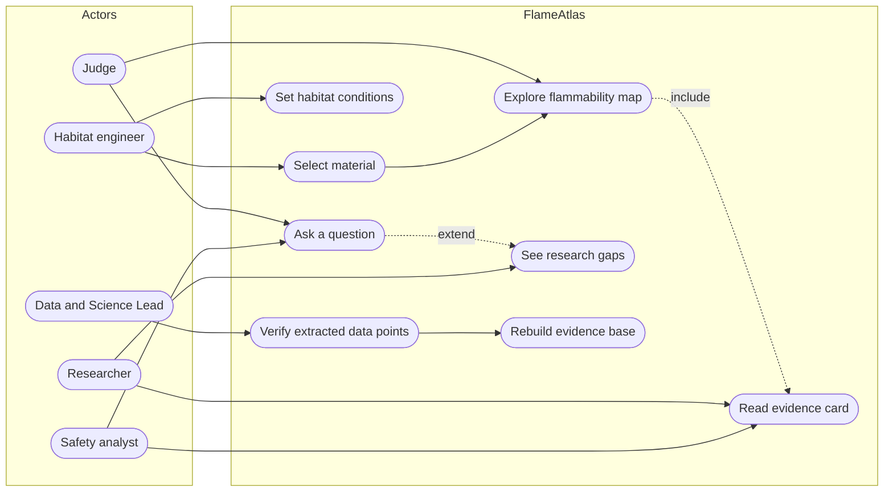

# 01 Product Requirements Document (PRD)

| Field | Value |
|---|---|
| Product | FlameAtlas |
| Document owner | Md. Mahmudul Hasan (Team Lead, AI and RAG) |
| Contributors | Aurin Subah (science), Opi Mojumdar (dashboard), Syed Mehedi Hussain (integration and QA), Farhan Alam Chowdhury (story) |
| Status | Baseline v1.0 |
| Related | [TRD](02-TRD.md), [DRD](04-DRD.md), [Test plan](07-test-plan.md) |

| Version | Date | Change |
|---|---|---|
| 1.0 | 2026-10-24 | First baseline, written from the project brief, the pitch deck, and the NASA data downloaded on 2026-10-24 |

---

## 1. Summary

FlameAtlas is a web dashboard that answers one question for people designing spacecraft and habitats: **"Will this material burn up there?"**

It has exactly three features:

1. **Flammability Map** (hero feature). Pick a material and see every hand-checked NASA test result plotted by airflow speed and oxygen level, with the boundary between "burns" and "goes out". Two sliders place your habitat's conditions on the map.
2. **AI Evidence Cards.** Every NASA study becomes a short, structured card: material, conditions, outcome, key finding, safety takeaway, and a link to the source.
3. **Ask FlameAtlas.** A question box that answers in plain language using only retrieved NASA passages, shows a confidence level, cites its sources, and says clearly when NASA has no data.

The three features read from one shared, hand-checked evidence base, so the map, the cards and the answers always agree with each other.

## 2. Problem

### 2.1 Fire behaves differently in microgravity

On Earth, hot combustion gases rise and pull fresh air into a flame (buoyant convection). In microgravity there is no "up", so a flame only gets oxygen from diffusion and from whatever airflow the cabin fans provide. Two consequences matter for safety:

- **Too little airflow** starves the flame and it goes out (quenching extinction).
- **Too much airflow** blows the flame off the material (blowoff extinction).
- Between the two lies a band of gentle airflow in which a material burns at **lower oxygen levels than it would on Earth**.

NASA's BASS-II experiment on the International Space Station measured this directly. For PMMA (acrylic) rods, flames survived down to about **13.5% O2** in a narrow band of low flow, well below the **15.4% O2** limit for upward burning on Earth. The authors call this a "Goldilocks" zone and note that it is "unfortunately typical of spacecraft ventilation flows near surfaces" (NTRS 20210011385, Section 6.1.4.4). When plotted with airflow on a log axis, the boundary has the classic **U shape**.

### 2.2 Earth tests can mislead in both directions

- Saffire-II (PSI-99, uncrewed Cygnus vehicle) burned silicone samples that **burned completely in normal-gravity tests but barely burned in microgravity** (burn length "~ 0" in microgravity versus "Complete" in 1-g for sample 2-1).
- Thin cotton-fiberglass fabric (SIBAL) only burns **downward in lunar gravity** in air, while on Earth it goes out right after ignition (NTRS 20240015307).
- NASA's materials screening test (NASA-STD-6001 Test 1) is an upward-burning test in normal gravity. BASS-II was designed to "bridge the gap" between that test and real flammability in space (PSI-25 objectives).

### 2.3 New habitats raise oxygen levels

Exploration habitats and landers are planned around reduced-pressure, oxygen-enriched atmospheres: **10.2 psia with 26.5% O2** and **8.2 psia with 34% O2**. A 2026 NASA assessment found that for the 8.2 psia / 34% O2 case, flammability was a concern for ISS heritage materials and "in the majority of cases ... alternate materials will need to be developed" (NTRS 20260003925). Almost all microgravity flammability tests were run at or below 22% O2, so engineers are often working outside the tested range without knowing it.

### 2.4 The knowledge is scattered

Results from BASS, BASS-II, Saffire I to VI, SoFIE, FLEX and related ground tests sit in dozens of papers, presentations and data archives. NASA's Physical Sciences Informatics archive (PSI) holds the test logs, but the logs mostly record **conditions**, not **outcomes**; the outcomes (burned, quenched, blew off, did not ignite) are in the papers. Nobody has put the two together in a form a design engineer can query in seconds.

### 2.5 Problem statement

> Spacecraft and habitat designers cannot quickly see whether a candidate material will sustain a flame at their planned oxygen level, pressure and ventilation in reduced gravity, because the relevant NASA results are scattered across many sources and are rarely summarized as burn or no-burn boundaries.

## 3. Goals and non-goals

### 3.1 Product goals

| ID | Goal | Measured by |
|---|---|---|
| G-1 | Show, in under two seconds of looking, whether a chosen material burns at a chosen oxygen level and airflow | Map renders with outcome zones and habitat status ([NFR-PERF-01](#8-non-functional-requirements)); hallway test: 4 of 5 first-time viewers state the correct status within 5 s |
| G-2 | Make every claim traceable to a specific NASA test or document | 100% of map points and card fields link to a source and locator (page, table or row) |
| G-3 | Never overstate certainty | 100% of answers carry a confidence level; questions with no matching evidence return a research-gap flag instead of an answer |
| G-4 | Show where NASA's data runs out | Untested conditions (for example 34% O2) are labeled `UNTESTED` on the map and flagged in answers |
| G-5 | Win on the five judging criteria | See [Section 11](#11-judging-criteria-alignment) |

### 3.2 Non-goals

FlameAtlas is a decision-support and research-navigation tool. It will **not**:

- certify any material as safe or replace NASA-STD-6001 testing;
- predict flammability for materials or conditions that NASA has not tested (it may show the nearest tests, labeled as such);
- model fire spread through a full cabin, smoke transport, or suppression;
- cover liquid-fuel or gaseous-flame experiments (FLEX, ACME, SLICE) beyond citing them in answers; the map is for **solid materials**;
- require user accounts, store personal data, or let users upload documents (in the hackathon version).

## 4. Users

### 4.1 Personas

| Persona | Who they are | What they need | Feature they use first |
|---|---|---|---|
| **Priya, habitat materials engineer** | Selects cabin fabrics, foams and plastics for a lunar habitat | "At 34% O2 and 8.2 psia with gentle ventilation, which of my candidate materials have NASA data, and do they burn?" | Flammability Map |
| **Marcus, mission safety analyst** | Reviews fire risk for planned cabin settings before a mission | A defensible answer with sources he can paste into a review, plus an honest confidence level | Ask FlameAtlas |
| **Dr. Lin, combustion researcher** | Plans the next microgravity experiment | Where the gaps are: which materials, oxygen levels, pressures or gravity levels have no tests | Evidence Cards and research-gap flags |
| **Hackathon judge** | Has a few minutes per project | To see the idea work immediately and to trust that it is grounded in NASA data | The two-slider demo |

### 4.2 Primary user journey

1. Choose a material from the dropdown (for example "SIBAL cotton-fiberglass fabric").
2. See every hand-checked NASA test for that material on the map, colored and shaped by outcome.
3. Move the **oxygen** and **airflow** sliders (or choose a habitat preset such as "ISS cabin" or "Exploration atmosphere 8.2 psia / 34% O2") and read the habitat status: `DANGER`, `MARGINAL`, `SELF-EXTINGUISHES` or `UNTESTED`.
4. Click a dot to open the Evidence Card for the study behind it.
5. Ask a follow-up question in plain language and read a short cited answer with a confidence level.

*Figure 1. Use case view. Mermaid has no native UML use-case diagram, so actors are drawn as rounded nodes and use cases as stadium nodes; dashed edges are UML include and extend relationships.*

## 5. User stories and acceptance criteria

Acceptance criteria use Given / When / Then. Each story maps to functional requirements in Section 7 and to test cases in the [test plan](07-test-plan.md).

### US-01 Pick a material and see its tests (P0)
*As a habitat engineer, I want to pick a material and see every NASA test for it, so that I know what evidence exists.*

- **Given** the app is open, **when** I select a material, **then** the map shows one marker per verified test record for that material within 1 s.
- **Given** a material has verified records, **then** each marker shows outcome by color **and** shape, and a legend explains both.
- **Given** the material has zero verified records, **then** the map shows an empty-state message naming the material and states that NASA data is missing.

### US-02 See the burn boundary (P0)
*As a habitat engineer, I want to see where the material switches from burning to going out, so that I can choose safe operating conditions.*

- **Given** at least 8 verified records with at least 3 burning and 3 non-burning outcomes in the selected flow direction, **then** a boundary curve and shaded burn region are drawn.
- **Given** fewer records than that, **then** no boundary is drawn and the chart says "Not enough tests to draw a boundary; showing individual tests only."
- **Then** the area outside the tested envelope is visibly marked as untested.

### US-03 Place my habitat on the map (P0)
*As a habitat engineer, I want to set my habitat's oxygen and airflow, so that I can see whether my material would burn there.*

- **When** I move the oxygen or airflow slider, **then** the habitat marker moves and the status label updates within 300 ms.
- **When** I pick a habitat preset, **then** oxygen, airflow and pressure are filled in from the preset.
- **Given** my conditions are outside the tested envelope, **then** the status is `UNTESTED`, never `SELF-EXTINGUISHES`.
- **Given** my pressure differs from the tested pressure by more than 15 kPa, **then** a warning says the tests were run at a different pressure.
- **Then** the three nearest verified tests are listed with their outcomes and distances.

### US-04 Open the evidence behind a point (P0)
*As a safety analyst, I want to click a data point and read the study it came from, so that I can judge it myself.*

- **When** I click a marker, **then** the Evidence Card for that record's source opens.
- **Then** the card shows experiment, material, conditions, outcome, key finding, safety takeaway, and a working link to the NASA source with a page, table or figure locator.

### US-05 Browse evidence cards (P1)
*As a researcher, I want to browse and filter all evidence cards, so that I can see what has been studied.*

- **When** I open the Evidence tab, **then** I can filter cards by material and experiment.
- **Then** each card is labeled `Verified` or `AI-extracted, not yet verified`; unverified cards are hidden by default.

### US-06 Ask a question in plain language (P0)
*As a safety analyst, I want to ask a question in my own words and get a short, cited answer, so that I can use it in a review.*

- **When** I ask "Is cotton fabric safe in a lunar habitat with low airflow?", **then** I get an answer of at most 120 words that cites 1 to 3 NASA sources inline.
- **Then** the answer shows a confidence level of `High`, `Medium` or `Low` with a one-line reason.
- **Then** every sentence with a factual claim carries at least one citation; cited passages can be expanded to show the exact quoted text.

### US-07 Be told when NASA has no data (P0)
*As a researcher, I want the assistant to admit when NASA has no data, so that I do not rely on a made-up answer.*

- **Given** no verified record or retrieved passage matches the material and gravity level asked about, **then** the reply is a research-gap flag (for example "No NASA data for Nomex at Mars gravity yet") and no generated answer.
- **Given** the question is not about fire safety or materials, **then** the reply says the question is out of scope.

### US-08 Trust the data (P0)
*As a judge, I want to see that the data was checked by a person, so that I trust the map.*

- **Then** the app's About panel states how many records are on the map, how many sources they came from, and that each was hand-checked against the source.
- **Then** only records with status `verified` are drawn on the map.

### US-09 Verify extracted data (P0, internal)
*As the Data and Science Lead, I want to review every AI-extracted data point against its source, so that only correct points reach the map.*

- **Given** the extraction run has produced candidate records, **when** I open the review file, **then** each row shows the extracted values next to the source locator.
- **When** I mark a row `verified` or `rejected` and run the validator, **then** schema errors are reported and verified rows are published to the map.

### US-10 Rebuild the evidence base from scratch (P1, internal)
*As the integration lead, I want one command that rebuilds the evidence base, so that the app is reproducible.*

- **When** I run the build command on a clean checkout with the raw data present, **then** the verified records, cards and search index are rebuilt without manual steps and the app starts.

## 6. Scope

### 6.1 Materials (target 5 to 8)

The final list is **TBD(Oct 28)**, after the official challenge datasets are reviewed. The candidate list below is drawn from the PSI test logs and papers already downloaded, ranked by how much outcome data exists.

| # | Material | Description | Main sources | Expected data density |
|---|---|---|---|---|
| 1 | SIBAL fabric | Cotton-fiberglass composite fabric (75% cotton, 25% fiberglass by mass); stands in for cabin textiles | BASS (PSI-26), BASS-II Table 7.1 (31 tests with flow, O2 and outcome), Saffire I to III | High |
| 2 | PMMA thin film | Acrylic film, 0.1 to 0.4 mm | BASS-II (PSI-25) | Medium |
| 3 | PMMA slab | Acrylic slab, 1 to 5 mm, one or two sides burning | BASS-II Table 5.1 (20 tests), Saffire-II | Medium |
| 4 | PMMA rod | Clear and black acrylic rods, 6 to 13 mm | BASS-II flammability boundary (Eq. 6.1, Figures 6.9 and 6.10) | High |
| 5 | Nomex | Aramid fabric used in flight suits and bags | BASS, BASS-II, Saffire-II and VI (did not ignite) | Low |
| 6 | Silicone | Silicone rubber sheet | Saffire-II, NTRS 20150022421 | Low |
| 7 | Ultem | Polyetherimide sheet | BASS (2 tests) | Very low (likely gap demonstration only) |

Wax and candle samples in BASS are excluded because they are not spacecraft materials.

### 6.2 MoSCoW

| Must (P0) | Should (P1) | Could (P2) | Won't (this version) |
|---|---|---|---|
| Map for at least 5 materials with verified points | Evidence tab with filters | Review page in the app for the Data Lead | User accounts |
| Boundary fit with untested envelope | Habitat presets | Download map as PNG | Upload your own paper |
| Habitat sliders and four-state status | Three nearest tests list | API or MCP server exposing the evidence base | Cabin-scale fire simulation |
| Evidence card on point click | Confidence reason text | Partial-gravity results on the map | Certification or pass/fail claims |
| Ask with citations, confidence, gap flag | Pressure mismatch warning | Bengali interface text | |
| About panel with data counts | Rebuild command | | |

## 7. Functional requirements

### 7.1 Flammability Map (`FR-MAP`)

| ID | Requirement | Priority | Story |
|---|---|---|---|
| FR-MAP-01 | The map must plot airflow speed (cm/s, log scale) on the x-axis and oxygen (% by volume) on the y-axis. | P0 | US-01 |
| FR-MAP-02 | The map must draw only records whose status is `verified`. | P0 | US-08 |
| FR-MAP-03 | Each marker must encode outcome by both color and shape: `burned`, `self_extinguished`, `no_ignition`. | P0 | US-01 |
| FR-MAP-04 | The user must be able to filter by flow direction (`concurrent`, `opposed`, `all`). Boundaries are fitted per flow direction. | P0 | US-02 |
| FR-MAP-05 | The map must draw a boundary curve (burn probability 0.5) and shade the burn region when the data-sufficiency rule in [AI/RAG spec](06-ai-rag-spec.md#5-flammability-boundary-model) is met, and must otherwise show points only with an explanatory note. | P0 | US-02 |
| FR-MAP-06 | The map must shade the region outside the tested envelope and label it "Untested". | P0 | US-02 |
| FR-MAP-07 | Two sliders must set habitat oxygen (10 to 40%) and airflow (0.5 to 60 cm/s); a third control sets pressure (30 to 110 kPa). | P0 | US-03 |
| FR-MAP-08 | The app must classify the habitat point into exactly one status: `DANGER`, `MARGINAL`, `SELF-EXTINGUISHES`, `UNTESTED`, or `NO BOUNDARY` (when no boundary exists), using the rules in the AI/RAG spec. | P0 | US-03 |
| FR-MAP-09 | The app must offer habitat presets: ISS cabin (101.3 kPa, 21% O2), Exploration 10.2 psia (70.3 kPa, 26.5% O2), Exploration 8.2 psia (56.5 kPa, 34% O2), each with a default airflow of 10 cm/s that the user can change. | P1 | US-03 |
| FR-MAP-10 | The app must list the three nearest verified tests to the habitat point with outcome and normalized distance. | P1 | US-03 |
| FR-MAP-11 | The app must warn when the habitat pressure differs from the median tested pressure for the material by more than 15 kPa. | P1 | US-03 |
| FR-MAP-12 | Clicking a marker must open the Evidence Card for that record's source. | P0 | US-04 |

### 7.2 Evidence Cards (`FR-CARD`)

| ID | Requirement | Priority | Story |
|---|---|---|---|
| FR-CARD-01 | Each card must show: experiment, material(s), conditions (O2, flow, pressure, gravity), outcome summary, key finding (one sentence), safety takeaway (one or two sentences), source title, source link, and locator. | P0 | US-04 |
| FR-CARD-02 | Each card must show its verification status and the IDs of the records it supports. | P0 | US-05 |
| FR-CARD-03 | The Evidence tab must list cards with filters for material and experiment, and hide unverified cards unless the user turns on "Show unverified". | P1 | US-05 |
| FR-CARD-04 | Every card field generated by the AI must come from the structured extraction schema; free-form AI text must not appear on a card. | P0 | US-08 |

### 7.3 Ask FlameAtlas (`FR-ASK`)

| ID | Requirement | Priority | Story |
|---|---|---|---|
| FR-ASK-01 | The app must accept a plain-language question of up to 500 characters. | P0 | US-06 |
| FR-ASK-02 | The app must parse material, oxygen, pressure, airflow and gravity from the question when present. | P0 | US-06 |
| FR-ASK-03 | Answers must be generated only from retrieved NASA passages and verified records supplied in the prompt. | P0 | US-06 |
| FR-ASK-04 | Each answer must cite 1 to 3 sources, and each cited span must be viewable as exact quoted text. | P0 | US-06 |
| FR-ASK-05 | Each answer must show a confidence level computed by the deterministic rule in the AI/RAG spec, not by the language model. | P0 | US-06 |
| FR-ASK-06 | When the evidence rule returns `GAP`, the app must show a research-gap flag and must not call the language model to write an answer. | P0 | US-07 |
| FR-ASK-07 | The app must refuse out-of-scope questions with a fixed message. | P1 | US-07 |
| FR-ASK-08 | The app must show three example questions to new users. | P1 | US-06 |
| FR-ASK-09 | The app must limit each browser session to 20 questions and show a friendly message when the limit is reached. | P0 | NFR-COST-01 |

### 7.4 Data pipeline (`FR-DATA`)

| ID | Requirement | Priority | Story |
|---|---|---|---|
| FR-DATA-01 | Scripts must download the PSI and NTRS source data reproducibly (done: `scripts/fetch_psi.py`, `scripts/fetch_ntrs.py`). | P0 | US-10 |
| FR-DATA-02 | An extraction step must turn each source document into candidate records and one candidate card using the schema in the [data spec](05-data-spec.md). | P0 | US-09 |
| FR-DATA-03 | Every candidate record must carry a source locator precise enough for a person to find the value in under one minute. | P0 | US-09 |
| FR-DATA-04 | A validator must check every record against the schema and unit ranges before publishing. | P0 | US-09 |
| FR-DATA-05 | Only records marked `verified` by a named reviewer may be published to the map. | P0 | US-08 |
| FR-DATA-06 | A single build command must rebuild records, cards and the search index. | P1 | US-10 |

### 7.5 Application (`FR-APP`)

| ID | Requirement | Priority |
|---|---|---|
| FR-APP-01 | The app must be reachable at a public URL without login for the judging period. | P0 |
| FR-APP-02 | The About panel must show record, material and source counts, the data cutoff date, and the hand-check statement. | P0 |
| FR-APP-03 | The app must show a short disclaimer: FlameAtlas summarizes NASA research and does not certify materials. | P0 |
| FR-APP-04 | The app must credit NASA PSI and NTRS as data sources and link to them. | P0 |

## 8. Non-functional requirements

Targets are refined with measurement methods in the [TRD](02-TRD.md#4-quality-attributes).

| ID | Category | Requirement |
|---|---|---|
| NFR-PERF-01 | Performance | Map update after a slider move: at most 300 ms at the 95th percentile. |
| NFR-PERF-02 | Performance | Ask answer: median at most 10 s, 95th percentile at most 20 s, measured from submit to full answer. |
| NFR-PERF-03 | Performance | Cold start of the hosted app to first render: at most 60 s. |
| NFR-REL-01 | Reliability | If the language model API fails, the map and cards must keep working and Ask must show a clear error. |
| NFR-REL-02 | Reliability | The app must run with no network access except the language model API (all data and the index are bundled). |
| NFR-SEC-01 | Security | API keys must never be committed to git or shown in the browser. |
| NFR-SEC-02 | Security | User questions must be treated as untrusted input and must not change system instructions. |
| NFR-ACC-01 | Accessibility | Text and essential graphics must meet WCAG 2.1 AA contrast; outcome must never be shown by color alone. |
| NFR-ACC-02 | Accessibility | All controls must be operable by keyboard. |
| NFR-COST-01 | Cost | Total language model spend for the hackathon must stay under USD 25, with a per-day cap of USD 10 enforced in code. |
| NFR-MAINT-01 | Maintainability | The core logic (boundary fit, classification, confidence) must be pure functions with unit tests. |
| NFR-MAINT-02 | Maintainability | Adding a new material must require only data changes, not code changes. |

## 9. Success metrics

### 9.1 Product metrics (measured on the prototype)

| Metric | Definition | Target |
|---|---|---|
| Extraction accuracy | Share of AI-extracted field values that match the hand-checked values (field-level, rules in the [AI/RAG spec](06-ai-rag-spec.md#8-evaluation)) | At least 90% on numeric fields, at least 95% on outcome |
| Record coverage | Verified records on the map | At least 60 across at least 5 materials |
| Citation faithfulness | Share of answer sentences whose cited passage supports the sentence (manual review of 20 answers) | At least 95% |
| Gap correctness | Share of out-of-data test questions that return a gap flag instead of an answer | 100% |
| Time to status | Median time for a first-time user to read the habitat status | Under 5 s |

These numbers fill the Results slide in the pitch deck. **Only numbers we actually measure are shown**; until then the slide reads "How we will measure success".

### 9.2 Hackathon deliverables

| Deliverable | Requirement | Due |
|---|---|---|
| Project page on spaceappschallenge.org | Title, summary, challenge, demo link, repository link, data and resources used, AI use statement | 2026-11-15, 23:59 local time |
| Demo | 30-second video with English subtitles **or** up to 7 slides, hosted publicly | Same |
| Repository | Public GitHub repo with README and these docs | Same |
| Local deliverables (Dhaka) | 240-second presentation video (done) and 30-second video uploaded to the Local Lead's folder | Per the Dhaka program schedule |

Submission rules come from past Space Apps guides and must be re-checked when the 2026 guides are published: **TBD(Nov 13)**.

## 10. Assumptions and dependencies

| ID | Assumption or dependency | If wrong |
|---|---|---|
| A-1 | The official challenge datasets (released 2026-10-28) include or point to solid-material flammability data compatible with our schema. | Keep the pipeline generic; map whatever materials the datasets cover. |
| A-2 | Enough outcome data exists in papers to draw boundaries for at least 3 materials. | Show points only for the rest and lean on the gap flags. |
| A-3 | The team has an Anthropic API key with enough credit (about USD 25). | Fall back to the cheaper model setting described in ADR-0004. |
| A-4 | Streamlit Community Cloud stays free and available for the judging period. | Deploy the same container to another free host (TRD Section 7). |
| A-5 | Space Apps allows learning and data preparation before the hackathon, with the project itself built during it. | Confirm with the Local Lead; see risk R-09. |

## 11. Judging criteria alignment

The five criteria below are from previous Space Apps judging guides; confirm wording when the 2026 guide is released: **TBD(Nov 13)**.

| Criterion | How FlameAtlas earns it | Evidence a judge can check |
|---|---|---|
| Impact | Helps engineers choose materials for Moon and Mars habitats where oxygen-enriched atmospheres are planned | Exploration-atmosphere preset shows which materials are untested at 34% O2 |
| Creativity | Turns scattered fire research into one explorable map; the `UNTESTED` zone and research-gap flags make missing knowledge visible | Map shading and gap flags |
| Validity | Every point is a hand-checked NASA test with a locator; confidence is computed by a published formula, not by the AI | Click any dot; read the confidence reason |
| Relevance | Directly answers Flame in Freefall with NASA PSI and NTRS combustion data | About panel and data credits |
| Presentation | The two-slider demo explains the idea in seconds | 30-second video |

## 12. Open questions

| # | Question | Owner | Resolves |
|---|---|---|---|
| Q-1 | Final 5 to 8 materials | Aurin Subah | TBD(Oct 28) |
| Q-2 | Do the official datasets add materials or partial-gravity results? | Aurin Subah | TBD(Oct 28) |
| Q-3 | Exact 2026 judging criteria and submission fields | Farhan Alam Chowdhury | TBD(Nov 13) |
| Q-4 | Team name | Whole team | Before registration closes |
| Q-5 | Are the Dhaka local dates Nov 13 to 14 (program schedule) or Nov 14 to 15 (global)? | Syed Mehedi Hussain | Ask the Local Lead |
