# 03 System Design Document (SDD)

| Field | Value |
|---|---|
| Product | FlameAtlas |
| Document owner | Syed Mehedi Hussain (Integration and QA) |
| Contributors | Md. Mahmudul Hasan, Opi Mojumdar, Aurin Subah |
| Status | Baseline v1.0 |
| Related | [TRD](02-TRD.md), [Data spec](05-data-spec.md), [AI/RAG spec](06-ai-rag-spec.md) |

| Version | Date | Change |
|---|---|---|
| 1.0 | 2026-10-24 | First baseline |

---

## 1. Design overview

FlameAtlas has two halves that never run at the same time:

1. **An offline pipeline** that turns NASA sources into a hand-checked evidence base. It runs on a developer laptop before the demo.
2. **An online app** that reads the evidence base and answers users. It runs on Streamlit Community Cloud.

The only bridge between them is a set of committed files: `data/curated/*.csv`, `data/processed/cards.jsonl` and `data/processed/chroma/`. Because the map, the cards and the assistant all read those same files, they cannot disagree.

Three design principles drive every choice below:

| Principle | What it means in the design |
|---|---|
| **A person checks, the AI proposes** | The language model only ever produces *candidate* records. A record reaches the map only after the Data and Science Lead marks it `verified`. |
| **Deterministic where it matters** | Habitat status and answer confidence are computed by plain Python rules, not by the language model, so they are repeatable and explainable. |
| **Fail toward honesty** | Whenever data is missing or out of range, the system says `UNTESTED`, `NO BOUNDARY` or `GAP` instead of guessing. |

## 2. System context (C4 level 1)

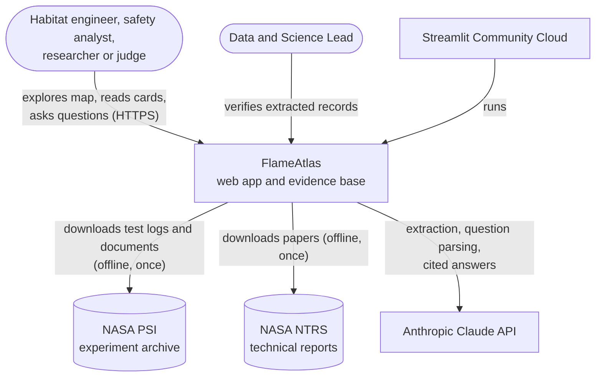

*Figure 1. FlameAtlas and the people and systems around it. NASA systems are only contacted by the offline pipeline.*

## 3. Containers (C4 level 2)

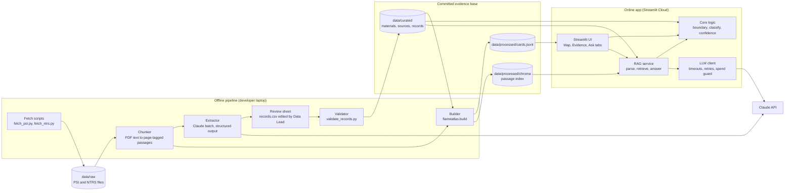

*Figure 2. Containers. Solid boxes are processes; cylinders are files. The committed evidence base is the contract between the two halves.*

| Container | Technology | Responsibility | Owner |
|---|---|---|---|
| Fetch scripts | Python standard library | Reproducible download of PSI and NTRS data | Syed Mehedi Hussain |
| Chunker | PyMuPDF | Split each PDF into passages tagged with source and page | Md. Mahmudul Hasan |
| Extractor | Claude Message Batches, pydantic | Propose candidate records and one card per source | Md. Mahmudul Hasan |
| Review sheet | CSV in a spreadsheet | Human verification of every candidate record | Aurin Subah |
| Validator | pydantic, pandas | Schema, unit-range and cross-reference checks | Aurin Subah |
| Builder | Python | Rebuild cards and the Chroma index from verified data | Syed Mehedi Hussain |
| Streamlit UI | Streamlit, Plotly | Three tabs, sliders, map, cards, chat | Opi Mojumdar |
| Core logic | scikit-learn, NumPy | Boundary fit, envelope, habitat status, nearest tests, confidence | Aurin Subah (science), Opi Mojumdar (integration) |
| RAG service | ChromaDB, Claude | Question parsing, retrieval, cited answers, gap flags | Md. Mahmudul Hasan |
| LLM client | `anthropic` SDK | One place for model IDs, timeouts, retries, cost tracking | Md. Mahmudul Hasan |

## 4. Components inside the app

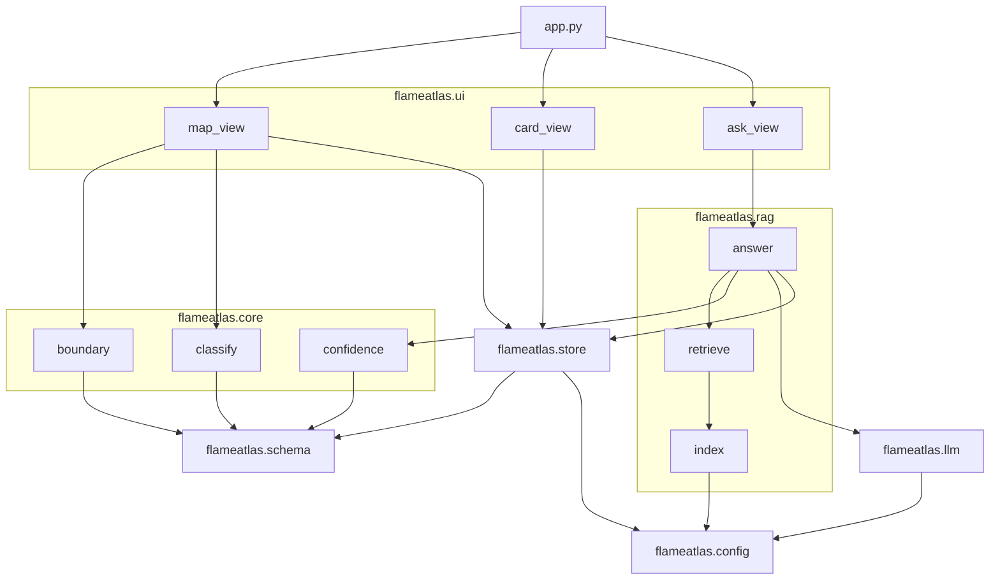

*Figure 3. Python modules and their imports. Arrows point from the importer to the imported module. `core` never imports `ui`, `rag` or `llm`, which keeps it testable without Streamlit or the network.*

## 5. Domain model

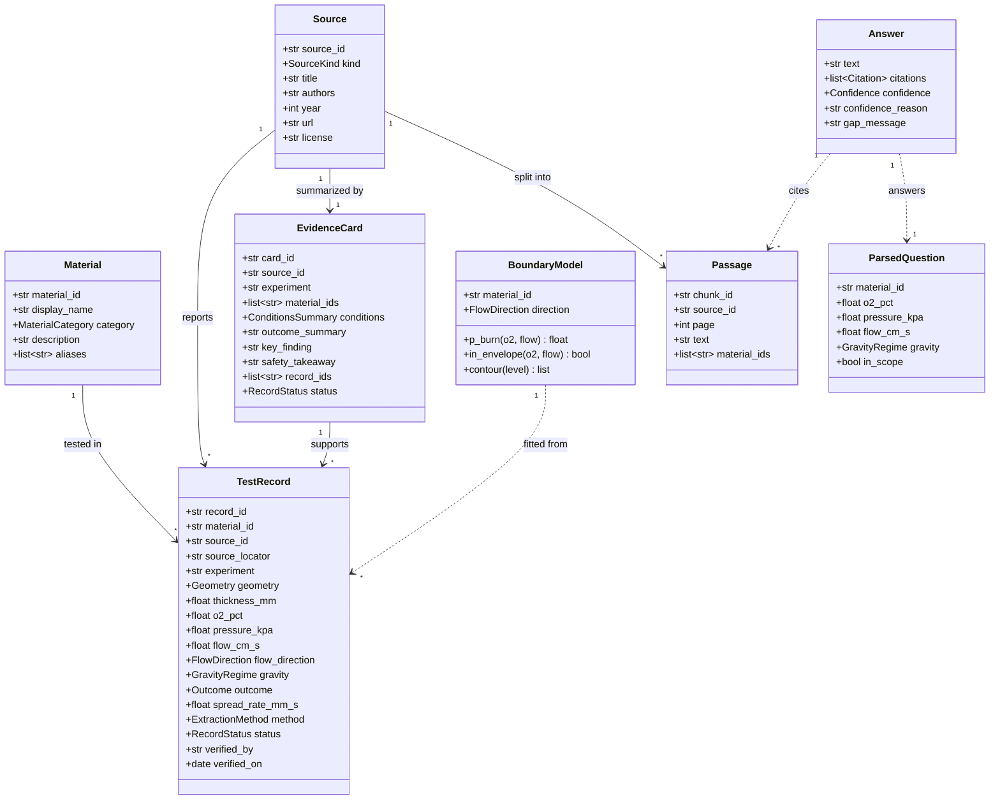

*Figure 4. UML class diagram of the domain model. Enumerations are listed in the [data spec](05-data-spec.md#4-schemas). Solid arrows are associations stored in the data; dashed arrows are runtime dependencies.*

### 5.1 Storage view (entity relationship)

```mermaid
erDiagram
    MATERIAL ||--o{ TEST_RECORD : "is tested in"
    SOURCE ||--o{ TEST_RECORD : "reports"
    SOURCE ||--|| EVIDENCE_CARD : "is summarized by"
    EVIDENCE_CARD ||--o{ CARD_RECORD : "lists"
    TEST_RECORD ||--o{ CARD_RECORD : "appears in"
    SOURCE ||--o{ PASSAGE : "is split into"
    MATERIAL {
        string material_id PK
        string display_name
        string category
    }
    SOURCE {
        string source_id PK
        string kind
        string title
        string url
    }
    TEST_RECORD {
        string record_id PK
        string material_id FK
        string source_id FK
        float o2_pct
        float flow_cm_s
        float pressure_kpa
        string outcome
        string status
    }
    EVIDENCE_CARD {
        string card_id PK
        string source_id FK
        string key_finding
        string status
    }
    CARD_RECORD {
        string card_id FK
        string record_id FK
    }
    PASSAGE {
        string chunk_id PK
        string source_id FK
        int page
    }
```

*Figure 5. Entity relationships as stored in CSV, JSONL and Chroma metadata. `CARD_RECORD` is the `record_ids` list inside each card.*

## 6. Key interactions

### 6.1 Moving a habitat slider

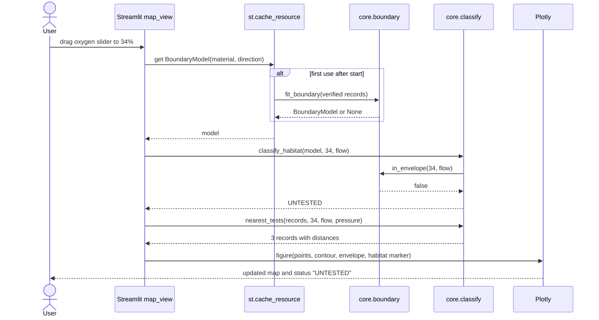

*Figure 6. Slider interaction. The model is fitted once per material and flow direction; each slider move costs one classification and one redraw (target under 300 ms).*

### 6.2 Asking a question

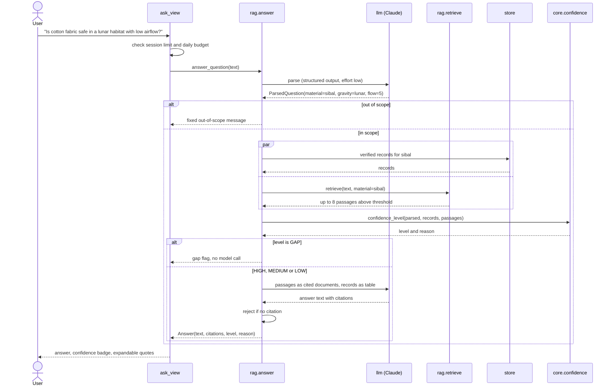

*Figure 7. Ask flow. Confidence is computed before generation, so a `GAP` result never calls the model to write an answer.*

### 6.3 Extracting and verifying a source

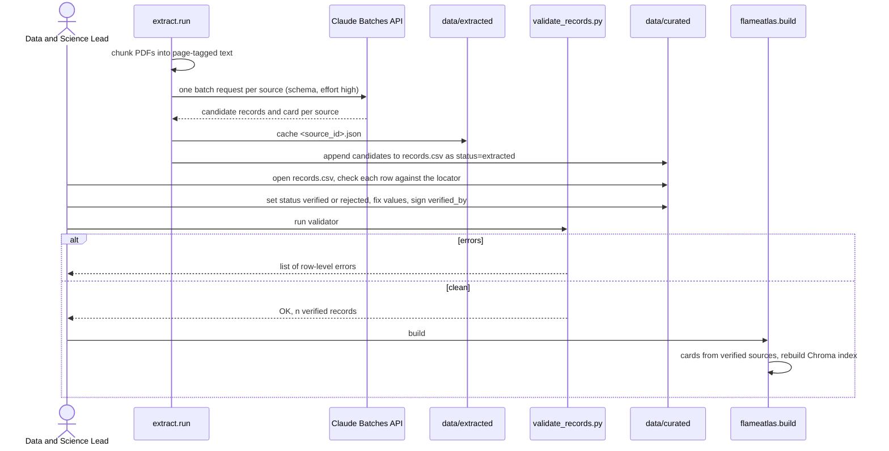

*Figure 8. The human check sits between the model and the map. Nothing marked `extracted` or `rejected` is ever drawn.*

## 7. Pipeline activity

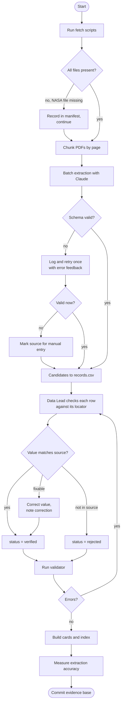

*Figure 9. Activity diagram of the offline pipeline, including the two failure paths: NASA files that no longer exist and model output that fails the schema.*

## 8. Lifecycles

### 8.1 Test record

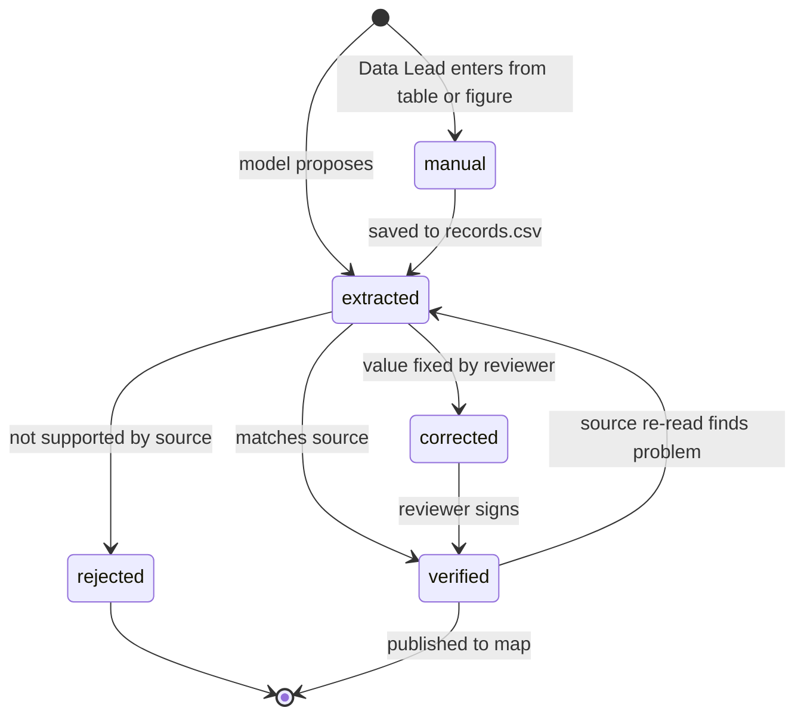

*Figure 10. Record states. `corrected` is recorded in the `notes` column; the stored `status` value is one of `extracted`, `verified`, `rejected`.*

### 8.2 Ask request

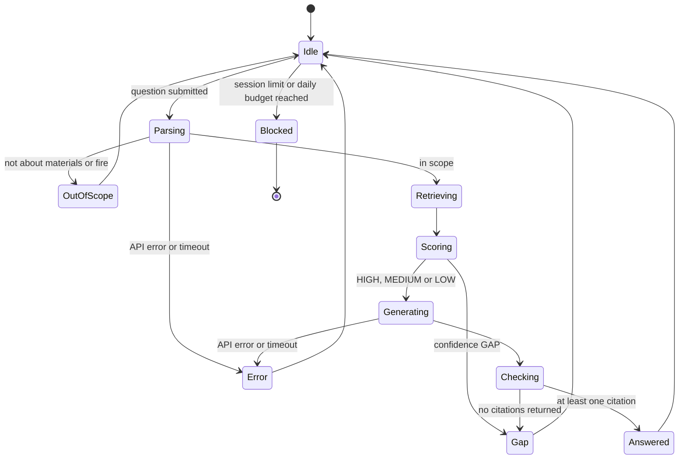

*Figure 11. States of one Ask request as shown to the user.*

## 9. Deployment

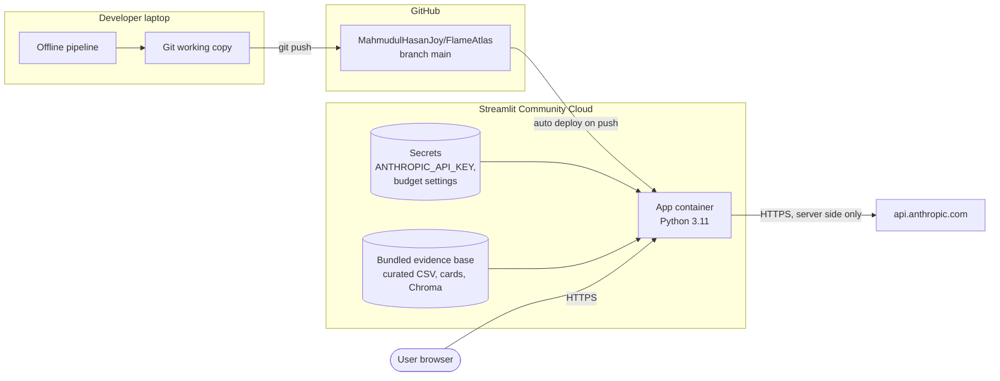

*Figure 12. Deployment view. The API key exists only in the host's secret store; the browser never talks to the Claude API directly.*

## 10. Cross-cutting design

### 10.1 Caching

| What | Where | Invalidation |
|---|---|---|
| Curated tables, cards | `st.cache_data`, keyed by file modification time | New deploy or file change |
| Boundary models | `st.cache_resource`, keyed by material and flow direction | New deploy |
| Chroma client | `st.cache_resource`, one per process | New deploy |
| Extraction results | `data/extracted/<source_id>.json` | `--force` flag |
| Daily spend counter | `st.cache_resource` dictionary keyed by UTC date, mirrored to `logs/spend.jsonl` | Date change |

### 10.2 Error handling

| Failure | Detected by | User sees | System does |
|---|---|---|---|
| Claude API 429 or 5xx | SDK exception | "The assistant is busy; try again in a minute." | Two retries with backoff, then give up |
| Claude API timeout (30 s) | Timeout | Same message | Logged |
| Missing API key | Config check at start | Ask tab shows "Assistant not configured"; map and cards work | Logged once |
| Budget exhausted | Spend guard | "Today's question budget is used up. The map and evidence cards still work." | Ask disabled until UTC midnight |
| Schema error in curated data | Validator at load | App shows "Data error in records.csv row 42: o2_pct out of range" | App stops loading that file; other tabs still load |
| No verified records for material | `store` query | Empty state on map | Nothing else |
| Model returns no citations | Answer check | Gap message | Answer discarded and logged |

### 10.3 Security

- The API key is read from the environment or Streamlit secrets and used only in `flameatlas/llm.py`.
- System prompts are constants. User text is placed inside a delimited block in the user turn (see [AI/RAG spec](06-ai-rag-spec.md#7-prompt-design)).
- Retrieved passages come only from the committed NASA corpus, so the indirect prompt-injection surface is limited to NASA documents.
- No user data is stored beyond the session; logs in the hosted app omit question text.

### 10.4 Observability

Each request logs one JSON line (TR-20). During the hackathon the team watches the Streamlit Cloud log stream; after the demo the spend log is checked against the Anthropic console.

## 11. Design decisions summary

Full reasoning lives in the [decision log](10-decisions.md).

| Decision | Chosen | Main alternative rejected |
|---|---|---|
| UI framework | Streamlit | React with a Python API (two codebases in 48 hours) |
| Grounding | RAG over a local Chroma index | Model's own knowledge (unverifiable); MCP server (setup cost, no visible benefit) |
| Language model | Claude Opus 5.5 with native citations | Other providers (no native citation spans) |
| Boundary | Logistic regression on O2, ln(flow), ln(flow)² with a tested envelope | Hand-drawn curve only (not reproducible) |
| Habitat labels | Four states including `UNTESTED`, no "Safe" label | Safe / Danger (overclaims safety) |
| Confidence | Deterministic rule | Model self-reported confidence (not calibrated) |
| Extraction input | Page-tagged text | Whole PDFs (several times more tokens per page) |
