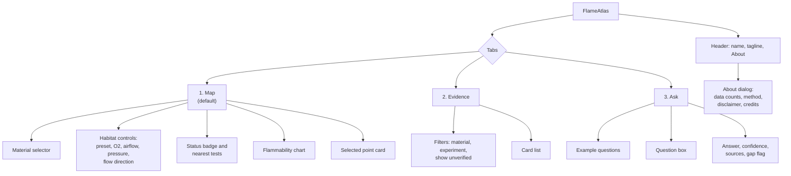

# 04 Design Requirements Document (DRD)

| Field | Value |
|---|---|
| Product | FlameAtlas |
| Document owner | Opi Mojumdar (Dashboard) |
| Contributors | Farhan Alam Chowdhury (copy and story), Aurin Subah (science wording) |
| Status | Baseline v1.0 |
| Related | [PRD](01-PRD.md), [SDD](03-SDD.md) |

| Version | Date | Change |
|---|---|---|
| 1.0 | 2026-10-24 | First baseline |

---

## 1. Design goals

| # | Goal | Design consequence |
|---|---|---|
| 1 | **Readable in two seconds.** A judge glancing at the screen must see whether the habitat is in danger. | One large status badge next to the chart; the chart has a single message: where the burn zone is and where you are. |
| 2 | **Honest by default.** The interface must never look more certain than the data. | No "Safe" label. Untested areas are visibly shaded. Unverified data is hidden. Every answer shows confidence. |
| 3 | **Evidence one click away.** | Every dot opens its card; every answer sentence links to a quoted passage. |
| 4 | **Plain language first, numbers second.** | Status words first ("Burns in tests"), numbers underneath. Jargon is explained in tooltips and the glossary. |
| 5 | **Nothing fancy.** | Streamlit's default components and one Plotly chart. No custom JavaScript, animation, or theme hacks. |

## 2. Information architecture



*Figure 1. Screens and their parts. The Map tab is the landing view because it carries the core idea.*

## 3. Layout

The app uses Streamlit's `wide` layout. Widths below assume a 1440 px laptop screen; on screens narrower than 900 px Streamlit stacks the columns vertically in the order shown.

### 3.1 Map tab

```text
┌──────────────────────────────────────────────────────────────────────────────┐
│ FlameAtlas · Know what burns before you fly.                       [About]   │
│ [ Map ]  [ Evidence ]  [ Ask ]                                               │
├───────────────────────────┬──────────────────────────────────────────────────┤
│ Material                  │  ┌─ Status ───────────────────────────────────┐  │
│ [SIBAL cotton-fiberglass▼]│  │  DANGER · Burns in NASA tests              │  │
│                           │  │  P(burn) 0.82 at 21% O2, 10 cm/s           │  │
│ Habitat preset            │  └────────────────────────────────────────────┘  │
│ [ISS cabin ▼]             │                                                  │
│                           │   O2 %                                           │
│ Oxygen  (% by volume)     │   40 ┤░░░░░░░░░░░░ untested ░░░░░░░░░░░░░░░░░░   │
│ ──────●────────── 21.0    │      ┤░░░░░░░░░░░░░░░░░░░░░░░░░░░░░░░░░░░░░░░░   │
│                           │   22 ┤      ● ●   burn region     ●   ●          │
│ Airflow (cm/s)            │      ┤   ■   ●  ★ habitat   ●      ■             │
│ ────●──────────── 10      │   17 ┤ ■  ■ ╲______ boundary ______╱ ■           │
│                           │      ┤    ✕       ■   ✕        ■                 │
│ Pressure (kPa)            │   10 ┼────┬──────┬──────┬──────┬────── flow cm/s │
│ [101.3]                   │       0.5    2      5     20     60  (log)       │
│                           │  ● burned  ■ self-extinguished  ✕ no ignition    │
│ Flow direction            │  ★ your habitat   ░ untested                     │
│ (•) Concurrent ( ) Opposed│                                                  │
│                           │  Nearest NASA tests                              │
│                           │  1. BASS-II GMT100-T6  4.5 cm/s 18.8%  burned    │
│                           │  2. ...                                          │
├───────────────────────────┴──────────────────────────────────────────────────┤
│ Selected point: Evidence card (appears after clicking a dot)                 │
└──────────────────────────────────────────────────────────────────────────────┘
```

*Figure 2. Map tab wireframe. Left column 30% width (controls), right column 70% (status, chart, nearest tests).*

### 3.2 Evidence tab

```text
┌──────────────────────────────────────────────────────────────────────────────┐
│ Material [All ▼]   Experiment [All ▼]   [ ] Show unverified   42 cards       │
├──────────────────────────────────────────────────────────────────────────────┤
│ BASS-II · NTRS 20210011385 · p. 99, Table 7.1                    ✔ Verified  │
│ Material   SIBAL cotton-fiberglass fabric                                    │
│ Conditions 16.4 to 21% O2 · 2 to 53 cm/s · ~101 kPa · microgravity · concur. │
│ Outcome    Burned at most conditions; quenched below 2.2 to 5 cm/s           │
│ Finding    Flames went out at 1 to 5 cm/s, at higher speed when O2 was lower.│
│ Takeaway   Very gentle airflow can still sustain a fabric fire; do not rely  │
│            on stopping ventilation to put it out at normal oxygen levels.    │
│ Source     Burning and Suppression of Solids-II Summary Report ↗             │
│ Supports   31 test records                                                   │
├──────────────────────────────────────────────────────────────────────────────┤
│ ... next card                                                                │
└──────────────────────────────────────────────────────────────────────────────┘
```

*Figure 3. Evidence tab wireframe. Cards are stacked full width; each card is a bordered container.*

### 3.3 Ask tab

```text
┌──────────────────────────────────────────────────────────────────────────────┐
│ Ask about NASA fire research. Answers use only NASA sources.                 │
│ Try: [Does Nomex burn in microgravity?] [What airflow puts out fabric fires?]│
│      [Is acrylic flammable at 34% oxygen?]                                   │
│ ┌──────────────────────────────────────────────────────────────┐  [ Ask ]    │
│ │ Is cotton fabric safe in a lunar habitat with low airflow?   │             │
│ └──────────────────────────────────────────────────────────────┘             │
├──────────────────────────────────────────────────────────────────────────────┤
│ ○ LOW confidence · tests exist only in microgravity; none at lunar gravity   │
│                                                                              │
│ In microgravity, cotton-fiberglass fabric kept burning at airflows as low as │
│ 2 to 5 cm/s at about 17 to 21% oxygen [1]. NASA notes that in lunar gravity  │
│ this fabric burns downward in air, while on Earth it goes out [2]. ...       │
│                                                                              │
│ ⚑ Research gap: no NASA tests of this fabric in lunar gravity with forced    │
│   airflow.                                                                   │
│                                                                              │
│ Sources                                                                      │
│ ▸ [1] BASS-II Summary Report, p. 99  "Quenching flow velocities were found…" │
│ ▸ [2] Flammability of Materials on the Moon, p. 1  "SIBAL fabric has been…"  │
│                                                                     7 of 20 │
└──────────────────────────────────────────────────────────────────────────────┘
```

*Figure 4. Ask tab wireframe. The example answer text is illustrative of format only; real answers come from the evidence base.*

## 4. The flammability chart

### 4.1 Axes

| Property | Specification | Reason |
|---|---|---|
| X axis | Airflow speed, cm/s, **log scale**, range 0.5 to 60 | NASA plots these boundaries on a log axis to show the U shape (NTRS 20210011385, Fig. 6.10); covers the BASS duct range up to 40 cm/s and blowoff sweeps up to 53 cm/s |
| Y axis | Oxygen, % by volume, linear, range 10 to 40 | Covers the lowest tested O2 (13.6% in BASS-II) up to the 34% exploration atmosphere |
| Tick labels | X: 0.5, 1, 2, 5, 10, 20, 50; Y: every 5% | Readable numbers on a log axis |
| Axis titles | "Airflow speed past the material (cm/s, log scale)" and "Oxygen (% by volume)" | Plain words, units in brackets |
| Zero flow | Tests at quiescent (0 cm/s) conditions are drawn at 0.5 cm/s with a hollow marker and the tooltip "No forced flow" | Log axes cannot show zero |

### 4.2 Marks

| Element | Shape | Color | Size | Notes |
|---|---|---|---|---|
| Burned | Filled circle | Vermillion `#D55E00` | 11 px | Okabe-Ito colorblind-safe palette |
| Self-extinguished | Filled square | Blue `#0072B2` | 11 px | |
| No ignition | Cross (x) | Dark gray `#595959` | 11 px | |
| Boundary (P = 0.5) | Solid line | Black `#101828` | 2 px | Only when a boundary exists |
| Burn region | Fill on the burning side of the boundary | `#D55E00` at 12% opacity | | |
| Untested area | Diagonal hatch fill outside the tested envelope | `#475467` at 25% opacity | | Plotly `fillpattern` with shape `/` |
| Habitat marker | Star with white outline | Black `#101828` | 20 px | Always on top |
| Selected record | Ring around the marker | Black, 2 px | | After click |

All marker colors have at least 3:1 contrast with the white background (vermillion 3.87:1, blue 5.19:1, gray 7.00:1), which meets WCAG 2.1 SC 1.4.11 for graphical objects. Shape alone also distinguishes every outcome, so the chart works in grayscale and for color-blind users.

### 4.3 Hover and click

- **Hover** on a marker shows: test label, experiment, outcome, O2, flow, pressure, thickness, and "Click for evidence".
- **Click** on a marker selects it and opens its Evidence Card below the chart (Streamlit `plotly_chart` with `on_select="rerun"`, single point selection).
- **Hover** on the boundary shows "Burn boundary fitted from n verified tests".
- **Hover** on the untested area shows "No NASA tests here".

### 4.4 Chart states

| State | Trigger | What is shown |
|---|---|---|
| Normal | Boundary exists | Points, boundary, burn region, untested hatch, habitat star |
| Points only | Data-sufficiency rule not met | Points, untested hatch, star; caption: "Not enough tests to draw a boundary (n burned, m not burned). Showing individual tests only." |
| Empty | Zero verified records for the material | No chart; message: "No verified NASA tests for {material} yet. This is a research gap." |
| Direction empty | Records exist only for the other flow direction | Message: "NASA tested {material} only in {other} flow. Switch flow direction to see them." |

## 5. Habitat status badge

The status badge is the most important element on the screen. It uses color **plus** an icon **plus** words.

| Status | Icon | Badge text | Sub-text | Background / text | Contrast |
|---|---|---|---|---|---|
| `DANGER` | ▲ | DANGER · Burns in NASA tests | "Burn probability {p:.2f} at these conditions." | `#FEF3F2` / `#B42318` | 6.05:1 |
| `MARGINAL` | ◆ | MARGINAL · Near the burn boundary | "Burn probability {p:.2f}. Small changes in oxygen or airflow could let it burn." | `#FFFAEB` / `#B54708` | 5.20:1 |
| `SELF-EXTINGUISHES` | ● | SELF-EXTINGUISHES · Went out in NASA tests | "Burn probability {p:.2f}. This is not a safety certification." | `#ECFDF3` / `#027A48` | 5.13:1 |
| `UNTESTED` | ? | UNTESTED · No NASA tests near these conditions | "Nearest tests are listed below. Do not assume this is safe." | `#F2F4F7` / `#475467` | 6.98:1 |
| `NO BOUNDARY` | ? | NOT ENOUGH DATA · Showing nearest tests only | "Too few tests to estimate a boundary for this material." | `#F2F4F7` / `#475467` | 6.98:1 |

All pairs pass WCAG 2.1 AA for normal text (at least 4.5:1). Contrast was computed with the WCAG relative-luminance formula.

Under the badge, when relevant:

- **Pressure warning** (FR-MAP-11): "NASA tested this material at about {p_test} kPa. Your habitat is at {p_hab} kPa. Lower pressure and higher oxygen can change flammability."
- **Gravity note** (always): "Map shows microgravity tests only."

## 6. Evidence card

| Field | Display rule |
|---|---|
| Header | `{experiment} · {source short id} · {locator}` and a status pill: "✔ Verified" (green text) or "AI-extracted, not yet verified" (gray text) |
| Material | Display names joined with commas |
| Conditions | `{o2 range}% O2 · {flow range} cm/s · {pressure} kPa · {gravity} · {direction}`; ranges collapse to one value when min equals max |
| Outcome | Outcome summary sentence |
| Finding | Exactly one sentence |
| Takeaway | One or two sentences, plain English, no imperative safety claims beyond what the source says |
| Source | Title as a link to the NTRS or PSI page, opening in a new tab |
| Supports | "{n} test records" |

Cards use `st.container(border=True)`. Field labels are bold and left-aligned in a two-column grid (`st.columns([1, 4])`).

## 7. Ask

| Element | Specification |
|---|---|
| Intro line | "Ask about NASA fire research. Answers use only NASA sources." |
| Examples | Three buttons; clicking one fills and submits the question. Examples: "Does Nomex burn in microgravity?", "What airflow puts out a fabric fire in microgravity?", "Is acrylic flammable at 34% oxygen?" |
| Input | `st.chat_input`, placeholder "Ask a question about a material, oxygen level or airflow", max 500 characters |
| Progress | Spinner text "Searching NASA sources..." then "Writing a cited answer..." |
| Confidence badge | `● HIGH`, `◐ MEDIUM`, `○ LOW` with the reason in plain words |
| Answer text | At most 120 words; citations as bracketed numbers `[1]` after the sentence they support |
| Sources | One expander per cited source: title, page, link, and the exact cited text in a quote block |
| Gap flag | Icon ⚑ and bold "Research gap:" followed by the gap message; shown alone when confidence is `GAP` |
| Out of scope | "FlameAtlas answers questions about how materials burn in space, using NASA research. Try one of the examples above." |
| Counter | "{used} of {limit} questions used this session", small gray text |
| Budget reached | Info box: "Today's question budget is used up. The map and evidence cards still work." Input disabled |
| Not configured | Info box: "The assistant is not configured on this server. The map and evidence cards still work." |

## 8. Copy guidelines

- Use "burned", "went out" and "did not ignite"; avoid "combusted", "extinguishment" and "deflagration" in the interface.
- Never use "safe" or "approved". Use "went out in NASA tests" or "self-extinguishes in tests".
- Numbers carry units every time: "21% O2", "10 cm/s", "101 kPa".
- Name the experiment and the source in every claim: "In BASS-II on the ISS..."
- Sentences are short. One idea per sentence.
- Tooltips explain jargon: "Concurrent flow: air moves the same way the flame spreads", "Opposed flow: air moves against the flame".

## 9. About dialog

Opened from the header (`st.dialog`). Contents, in order:

1. One-paragraph description of FlameAtlas.
2. Live counts: "{n_records} hand-checked test results, {n_materials} materials, {n_sources} NASA sources. Data as of {date}."
3. Method: "An AI reads NASA papers and proposes data points. A team member checks every point against the source before it appears on the map. Answers are written only from NASA passages and cite them."
4. Disclaimer: "FlameAtlas summarizes published NASA research for exploration and education. It does not certify materials and does not replace NASA-STD-6001 testing."
5. Credits: NASA Physical Sciences Informatics (PSI), NASA Technical Reports Server (NTRS), NASA Space Apps Challenge 2026, team names, link to the repository.

## 10. Accessibility checklist

| # | Requirement | Applies to |
|---|---|---|
| DR-01 | Outcome is encoded by shape and color; status by icon, word and color | Chart, badge |
| DR-02 | Text contrast at least 4.5:1, graphics at least 3:1 (values in Sections 4.2 and 5) | All |
| DR-03 | The app is locked to Streamlit's light theme in `.streamlit/config.toml`, because the chosen marker and badge colors fall below 3:1 on Streamlit's dark background (for example gray `#595959` measures 2.70:1 on `#0E1117`) | Theme |
| DR-04 | Every slider has a visible numeric value and a text label with units | Controls |
| DR-05 | All controls reachable with Tab; the chart has a text alternative: the status badge and nearest-tests table carry the same information | Map |
| DR-06 | Links that open new tabs say so in their tooltip | Cards |
| DR-07 | No information is conveyed only on hover; hover text duplicates data shown on click | Chart |
| DR-08 | No flashing or auto-playing media | All |

## 11. Demo path

The 30-second video and the live pitch follow the same path. Every step must work on the hosted app.

| Seconds | Action | What the viewer sees |
|---|---|---|
| 0 to 4 | App opens on Map, material SIBAL, preset "ISS cabin" | Dots, U-shaped boundary, star in burn region, badge `DANGER` |
| 4 to 10 | Drag airflow down to 2 cm/s | Star crosses the boundary; badge changes to `SELF-EXTINGUISHES` |
| 10 to 15 | Choose preset "Exploration 8.2 psia / 34% O2" | Star jumps into the hatched area; badge `UNTESTED`; pressure warning |
| 15 to 20 | Click a dot | Evidence card with NASA source and page |
| 20 to 28 | Ask "Is cotton fabric safe in a lunar habitat with low airflow?" | Cited answer, `LOW` badge (no lunar-gravity tests), research-gap flag |
| 28 to 30 | End card | "FlameAtlas · Know what burns before you fly." |

The exact outcome at each step depends on the verified data; rehearse with the final evidence base and adjust slider values so each step shows the intended state.
