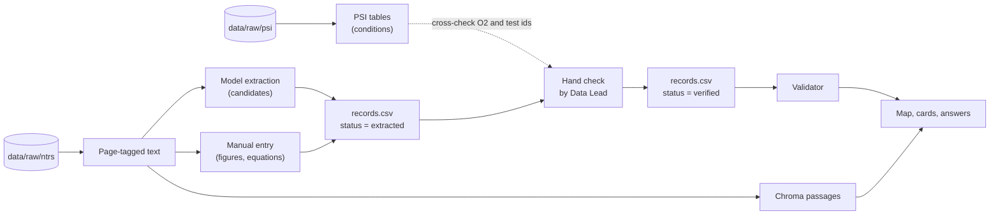
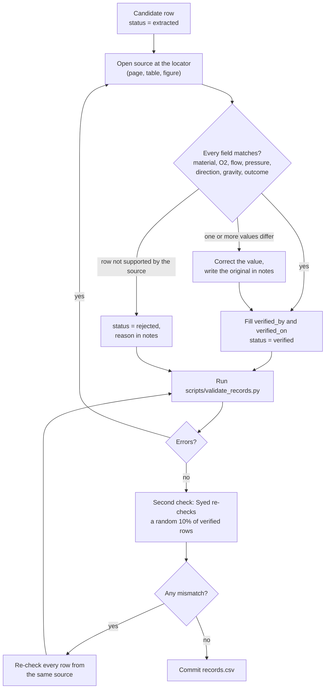

# 05 Data Specification

| Field | Value |
|---|---|
| Product | FlameAtlas |
| Document owner | Aurin Subah (Data and Science) |
| Contributors | Md. Mahmudul Hasan (extraction), Syed Mehedi Hussain (validation tooling) |
| Status | Baseline v1.0 |
| Related | [SDD](03-SDD.md), [AI/RAG spec](06-ai-rag-spec.md), [Test plan](07-test-plan.md) |

| Version | Date | Change |
|---|---|---|
| 1.0 | 2026-10-24 | First baseline, based on the PSI and NTRS data downloaded on 2026-10-24 |

---

## 1. Purpose

This document defines **what data FlameAtlas uses, how it is structured, and how each value is checked** before it reaches a user. If the app shows a number, this document says where that number came from and who checked it.

## 2. Source inventory

### 2.1 NASA Physical Sciences Informatics (PSI)

Downloaded with `scripts/fetch_psi.py` from https://psi.nasa.gov (linked from https://science.nasa.gov/biological-physical/data/). License: CC0-1.0.

All 24 investigations in the research area "Combustion Science" were fetched. Raw video and image data (hundreds of gigabytes to terabytes per investigation) was skipped. For every investigation we kept the investigation metadata, experimental table, metadata archive, science documents, reports and representative images. For the five solid-material investigations we also kept engineering documents, presentations, reference and analyzed data, and tabular raw telemetry.

| Accession | Acronym | Investigation | DOI | Role in FlameAtlas |
|---|---|---|---|---|
| PSI-26 | BASS | Burning and Suppression of Solids | 10.60555/58h4-dy80 | Core: solid materials, map data |
| PSI-25 | BASS-II | Burning and Suppression of Solids - II | 10.60555/4qc4-de67 | Core: solid materials, map data |
| PSI-98 | SAFFIRE-I | Spacecraft Fire Safety Experiment-I | 10.60555/0t15-1z43 | Core: large-scale fabric fire |
| PSI-99 | SAFFIRE-II | Spacecraft Fire Experiment-II | 10.60555/2chp-m469 | Core: microgravity vs 1-g outcomes |
| PSI-100 | SAFFIRE-III | Spacecraft Fire Experiment-III | 10.60555/040q-4h36 | Core: large-scale fabric fire |
| PSI-69 | FLEX | Flame Extinguishment Experiment | 10.60555/mbq8-0451 | Context for answers (liquid droplets, cool flames) |
| PSI-68 | FLEX-2 | Flame Extinguishment Experiment - 2 | 10.60555/byp8-h018 | Context for answers |
| PSI-39 | CFI | Cool Flames Investigation | 10.60555/m6pj-a914 | Context for answers |
| PSI-102, PSI-101 | SAME, SAME-R | Smoke and Aerosol Measurement | 10.60555/gd4k-8h62, 10.60555/2np7-jv14 | Context: smoke detection |
| PSI-107 | SPICE | Smoke Point In Co-flow Experiment | 10.60555/9kbh-e962 | Context |
| PSI-106 | SLICE | Structure and Liftoff In Combustion | 10.60555/pm12-rg61 | Context (gas flames) |
| PSI-10, 20, 21, 22, 23, 159 | ACME family | Advanced Combustion via Microgravity Experiments | see manifest | Context (gas flames) |
| PSI-47 | DAFT / DAFT-2 | Dust and Aerosol Measurement Feasibility Test | 10.60555/ztgj-d202 | Context: smoke detection |
| PSI-60, 62, 115, 117, 142 | (ground) | Analysis grants using flight data | see manifest | Context |

Result: **145 of 154 selected files downloaded (311 MB)**. Nine files are listed by PSI but missing from NASA's storage (the server returns `NoSuchKey`). They are recorded with `downloaded=False` in [`data/raw/psi/manifest.csv`](../data/raw/psi/manifest.csv). The most relevant missing file is the BASS final report (PSI-26). Its results are covered by NTRS 20140011099 and the BASS-II summary report.

### 2.2 NASA Technical Reports Server (NTRS)

Downloaded with `scripts/fetch_ntrs.py` from the curated list [`data/sources/ntrs_papers.csv`](../data/sources/ntrs_papers.csv). **43 of 43 PDFs downloaded (131 MB, 814 pages, about 243,000 words).** All have extractable text, so no OCR is needed.

| Topic | Papers | Examples |
|---|---|---|
| Flammability limits | 12 | BASS-II Summary Report (NTRS 20210011385), SIBAL boundary papers, quenching and blowoff extinction |
| Large-scale fire | 9 | Saffire I to VI results |
| Flame spread | 7 | Concurrent spread over fabric, thick PMMA, confinement effects |
| Material screening and test methods | 3 | Low-stretch apparatus, NASA-STD-6001 related |
| Ignition | 2 | Piloted ignition delay of PMMA in exploration atmospheres |
| Blowoff limits | 2 | Mixed convection blowoff for PMMA rods |
| Combustion products | 2 | BASS-II gas sensors, Saffire VI heat and smoke |
| Ignition and extinction (SoFIE) | 2 | SoFIE design and status |
| Fire safety overview | 2 | NASA GRC fire safety research, technology development plan |
| Habitat design | 1 | Reduced-pressure atmospheres and ECLSS (NTRS 20260003925) |
| Cool flames | 1 | FLEX droplet experiments |

### 2.3 Official challenge datasets

Released 2026-10-28. **TBD(Oct 28):** add each dataset here with its URL, license and role. The pipeline accepts any PDF, CSV or spreadsheet source; only the source list changes.

### 2.4 What each source type contributes

The most important finding from the download:

> **PSI experimental tables log test conditions, not outcomes.** The BASS table (PSI-26, 122 rows) lists date, test number and fuel sample only. The BASS-II table (PSI-25, 129 rows) adds sample, flow restrictor and fan settings and calibrated O2 (13.6% to 22.2%), but not whether the sample burned. Outcomes (burned, quenched, blew off, did not ignite) are reported in the **papers**.

| Source type | Gives us | Example |
|---|---|---|
| PSI experimental table | Test list, sample, measured O2, sometimes flow and burn time | PSI-25 table: 129 BASS-II tests with calibrated initial and final O2 |
| PSI table with outcomes (rare) | Outcomes directly | PSI-99 (Saffire-II): microgravity and 1-g burn length per sample; silicone "~ 0" in microgravity vs "Complete" in 1-g |
| NTRS paper table | Conditions and outcomes per test | NTRS 20210011385 Table 7.1: 31 SIBAL tests with flow, O2 and comments ("Quenched", "No ignition", "Blow-off") |
| NTRS paper figure | Boundary points that exist only as plotted symbols | NTRS 20210011385 Fig. 6.9: PMMA rod flammability boundary |
| NTRS paper equation | A published boundary | NTRS 20210011385 Eq. 6.1: X_O2 = 6 exp(-0.5a) + 0.0167a + 13.4 for PMMA rods, with a the stretch rate in 1/s |
| NTRS paper text | Findings and context for cards and answers | "Quenching flow velocities were found to be between 1 and 5 cm/s with higher velocity at lower O2 percentage" |

Consequence: **every map record comes from a paper table, a figure or a PSI table with outcomes, and is checked by a person.** PSI tables without outcomes are used to cross-check conditions (for example O2 for a given test number).

## 3. Data flow



*Figure 1. How raw files become map data. Dashed edge: PSI tables are used to confirm values, not as the only source of outcomes.*

## 4. Schemas

All schemas are implemented once as pydantic models in `flameatlas/schema.py`. CSV files use UTF-8, comma separators, a header row and `.` as the decimal separator. Empty cells mean "not reported".

### 4.1 Enumerations

| Enum | Values | Meaning |
|---|---|---|
| `MaterialCategory` | `fabric`, `polymer_film`, `polymer_solid`, `elastomer`, `other` | Broad family for filtering |
| `Geometry` | `flat_sheet`, `fabric_strip`, `slab`, `rod`, `sphere`, `cylinder`, `other` | Sample shape |
| `FlowDirection` | `concurrent`, `opposed`, `stagnation`, `quiescent` | Air moves with the flame, against it, into a rod tip, or not at all |
| `GravityRegime` | `micro`, `lunar`, `martian`, `earth`, `partial_other` | Gravity level of the test |
| `Outcome` | `burned`, `self_extinguished`, `no_ignition` | See Section 5 |
| `ExtinctionMode` | `quench`, `blowoff`, `burnout`, `other`, empty | How a flame went out, when known |
| `ExtractionMethod` | `llm`, `manual_table`, `manual_figure`, `manual_text` | How the value was obtained |
| `RecordStatus` | `extracted`, `verified`, `rejected` | Review state |
| `SourceKind` | `ntrs_paper`, `ntrs_presentation`, `psi_table`, `psi_document`, `challenge_dataset` | Where a source lives |

### 4.2 `data/curated/materials.csv`

| Column | Type | Required | Rule |
|---|---|---|---|
| `material_id` | string | yes | Lowercase slug, unique, for example `sibal` |
| `display_name` | string | yes | Name shown in the UI |
| `category` | `MaterialCategory` | yes | |
| `description` | string | yes | One sentence, plain language |
| `aliases` | string | no | Semicolon-separated names used in sources, for example `SIBAL;cotton-fiberglass;Cotton-Fiberglass (SIBAL)` |

Initial rows (final list TBD(Oct 28)):

| material_id | display_name | category |
|---|---|---|
| `sibal` | SIBAL cotton-fiberglass fabric | fabric |
| `pmma_film` | PMMA (acrylic) thin film | polymer_film |
| `pmma_slab` | PMMA (acrylic) slab | polymer_solid |
| `pmma_rod` | PMMA (acrylic) rod | polymer_solid |
| `nomex` | Nomex aramid fabric | fabric |
| `silicone` | Silicone rubber sheet | elastomer |
| `ultem` | Ultem (polyetherimide) sheet | polymer_solid |

### 4.3 `data/curated/sources.csv`

| Column | Type | Required | Rule |
|---|---|---|---|
| `source_id` | string | yes | `NTRS-<id>` or `PSI-<n>` or `CDS-<slug>` for challenge datasets |
| `kind` | `SourceKind` | yes | |
| `title` | string | yes | As published |
| `authors` | string | no | Semicolon-separated |
| `year` | int | yes | 1980 to 2026 |
| `url` | string | yes | Public landing page (NTRS citation page or PSI study page) |
| `license` | string | yes | For example `CC0-1.0`, `US Gov work`, `publisher` |
| `local_path` | string | no | Path under `data/raw/` |

### 4.4 `data/curated/records.csv` (map data)

One row is **one observed outcome at one set of conditions**. A test that swept the flow from 10 cm/s down to 2.2 cm/s produces two rows (Section 5.2).

| Column | Type | Unit | Required | Range or rule |
|---|---|---|---|---|
| `record_id` | string | | yes | `REC-00001`, assigned once, never reused |
| `material_id` | string | | yes | Must exist in `materials.csv` |
| `sample_variant` | string | | no | Short text such as `2.2 cm wide` or `3/8 in clear rod`; boundaries are fitted per variant when more than one exists |
| `source_id` | string | | yes | Must exist in `sources.csv` |
| `source_locator` | string | | yes | Page plus table, figure, row or test label, for example `p.96 Table 7.1 GMT100-T13` |
| `experiment` | string | | yes | `BASS`, `BASS-II`, `SAFFIRE-I`, ... |
| `test_label` | string | | no | Test number as printed in the source |
| `geometry` | `Geometry` | | yes | |
| `thickness_mm` | float | mm | no | 0.01 to 50 |
| `width_cm` | float | cm | no | 0.1 to 100 |
| `o2_pct` | float | % by volume | yes | 5 to 100 |
| `o2_note` | string | | no | For example `final O2`, `derived from CO2`, `reading may be inaccurate` |
| `pressure_kpa` | float | kPa | yes | 10 to 150 |
| `pressure_reported` | bool | | yes | `false` when the ISS nominal 101.3 kPa is assumed because the source does not state pressure |
| `flow_cm_s` | float | cm/s | yes | 0 to 300; 0 means quiescent |
| `flow_direction` | `FlowDirection` | | yes | |
| `gravity` | `GravityRegime` | | yes | |
| `outcome` | `Outcome` | | yes | |
| `extinction_mode` | `ExtinctionMode` | | no | Required when `outcome = self_extinguished` and the source says how |
| `spread_rate_mm_s` | float | mm/s | no | 0 to 100 |
| `exclude_from_fit` | bool | | yes | `true` keeps the point on the map but out of the boundary fit |
| `exclude_reason` | string | | no | Required when `exclude_from_fit = true` |
| `method` | `ExtractionMethod` | | yes | |
| `status` | `RecordStatus` | | yes | |
| `verified_by` | string | | no | Reviewer name; required when `status = verified` |
| `verified_on` | date | | no | ISO date; required when `status = verified` |
| `notes` | string | | no | Corrections and anything a reader should know |

### 4.5 `data/processed/cards.jsonl` (evidence cards)

One JSON object per line, one card per source that has at least one verified record or a verified finding.

```json
{
  "card_id": "CARD-NTRS-20210011385-T7.1",
  "source_id": "NTRS-20210011385",
  "experiment": "BASS-II",
  "material_ids": ["sibal"],
  "conditions": {"o2_pct": [16.4, 21.0], "flow_cm_s": [2.0, 53.0], "pressure_kpa": [101.3, 101.3],
                 "gravity": "micro", "flow_direction": ["concurrent"]},
  "outcome_summary": "Burned at most conditions; flames quenched as flow was reduced to 2 to 5 cm/s, and one narrow sample blew off at 47 cm/s.",
  "key_finding": "Quenching flow velocities were between 1 and 5 cm/s, higher at lower oxygen.",
  "safety_takeaway": "A cotton-fiberglass fabric fire can survive very gentle airflow in microgravity; slowing ventilation alone is not a reliable way to put it out.",
  "locator": "pp. 96-100, Table 7.1 and Fig. 7.7",
  "record_ids": ["REC-00001", "REC-00002"],
  "status": "verified",
  "model": "claude-opus-5-5",
  "extracted_on": "2026-11-14"
}
```

Card text fields have length limits enforced by the schema: `key_finding` at most 200 characters, `safety_takeaway` at most 300, `outcome_summary` at most 300.

### 4.6 Passage metadata (Chroma)

| Field | Type | Example |
|---|---|---|
| `chunk_id` | string | `NTRS-20210011385:p104:c02` |
| `source_id` | string | `NTRS-20210011385` |
| `page` | int | 104 (1-based PDF index; the printed page is 96) |
| `experiment` | string | `BASS-II` |
| `material_ids` | string | `sibal` (semicolon-separated; Chroma metadata values must be scalars) |
| `title` | string | Source title, for display |

## 5. Outcome rules

### 5.1 Definitions

| Outcome | Use when the source says... | Counts as burning in the fit |
|---|---|---|
| `burned` | The flame was stable or spread at this condition (including "no blowoff" and stable flames before a later change) | 1 |
| `self_extinguished` | The material ignited but the flame went out at this condition: quenched, blew off, or went out before burning the sample | 0 |
| `no_ignition` | The igniter ran but the material never sustained a flame | 0 |

Burnout (the flame consumed all the fuel) is `burned` with `extinction_mode = burnout`.

### 5.2 Flow sweeps

Many BASS and BASS-II tests changed the flow during one burn. A sweep is recorded as one row per flow value that the source reports:

| Source says | Rows created |
|---|---|
| Single flow, no failure comment | 1 row: that flow, `burned` |
| `A to B`, no failure comment | 2 rows: A `burned`, B `burned` |
| `A to B`, "Quenched" | 2 rows: A `burned`; B `self_extinguished`, `extinction_mode = quench` |
| `A to B`, "Blow-off" | 2 rows: A `burned`; B `self_extinguished`, `extinction_mode = blowoff` |
| `A to B`, "No blowoff" | 2 rows: A `burned`, B `burned` |
| Single flow, "No ignition" | 1 row: `no_ignition` |

Intermediate flows that the source does not list are not invented.

### 5.3 Worked example: NTRS 20210011385, Table 7.1

Table 7.1 ("Test summary of flat SIBAL fabrics in concurrent flow in BASS and BASS-II", printed p. 96, PDF p. 104) has 31 rows. Six rows, and the records they produce:

| Source row | Flow (cm/s) | O2 (%) | Comment | Records |
|---|---|---|---|---|
| GMT45-T4, 2.2 cm | 10 to 2.2 | 18.7 | Quenched | 10 `burned`; 2.2 `self_extinguished` (quench) |
| GMT45-T15, 2.2 cm | 10 to 29 | 18.7 | No blowoff | 10 `burned`; 29 `burned` |
| GMT175-T9, 2.2 cm | 10 | 16.4 | No ignition | 10 `no_ignition` |
| GMT190-T21, 1.2 cm | 11 to 47 | 17.2 | Blow-off | 11 `burned`; 47 `self_extinguished` (blowoff) |
| GMT190-T23, 2.2 cm | 10 | 17.2 | Reused, did not ignite | 10 `no_ignition`, `exclude_from_fit = true`, reason "reused sample" |
| GMT45-T1, 2.2 cm | 10 | 18.5 (footnote b) | none | 10 `burned`, `o2_note = "reading may be inaccurate"`, `exclude_from_fit = true` |

As CSV (columns abbreviated to those that vary):

```csv
record_id,material_id,sample_variant,source_id,source_locator,experiment,test_label,o2_pct,pressure_kpa,pressure_reported,flow_cm_s,flow_direction,gravity,outcome,extinction_mode,exclude_from_fit,exclude_reason,method,status
REC-00001,sibal,2.2 cm wide,NTRS-20210011385,p.96 Table 7.1 GMT45-T4,BASS-II,GMT45-T4,18.7,101.3,false,10,concurrent,micro,burned,,false,,manual_table,verified
REC-00002,sibal,2.2 cm wide,NTRS-20210011385,p.96 Table 7.1 GMT45-T4,BASS-II,GMT45-T4,18.7,101.3,false,2.2,concurrent,micro,self_extinguished,quench,false,,manual_table,verified
REC-00003,sibal,2.2 cm wide,NTRS-20210011385,p.96 Table 7.1 GMT175-T9,BASS-II,GMT175-T9,16.4,101.3,false,10,concurrent,micro,no_ignition,,false,,manual_table,verified
REC-00004,sibal,1.2 cm wide,NTRS-20210011385,p.96 Table 7.1 GMT190-T21,BASS-II,GMT190-T21,17.2,101.3,false,47,concurrent,micro,self_extinguished,blowoff,false,,manual_table,verified
```

(`verified_by` and `verified_on` omitted here for width.)

### 5.4 Data that cannot be a map point

| Case | Handling |
|---|---|
| Boundary given only as an equation (BASS-II Eq. 6.1 for PMMA rods, in stretch rate a rather than flow) | Not converted to points. Stored as a card finding and quoted in answers. A rod map uses digitized figure points (`manual_figure`) when the Data Lead enters them, with the figure number as the locator. |
| Saffire burn lengths and spread rates at a single flow | `burned` or `self_extinguished` records at that flow; spread rate filled when reported |
| Gas-flame and droplet experiments (ACME, FLEX, CFI) | No map records; indexed as passages for answers |

## 6. Verification workflow



*Figure 2. Every row is checked by the Data and Science Lead; a random 10% sample is re-checked by a second person.*

Rules for reviewers:

1. Check against the **source**, never against the model's explanation.
2. Use the value as printed. Convert units with the table in Section 7 and note the conversion.
3. If the source gives a range (for example "21.5 - 21.7"), store the midpoint and write the range in `o2_note`.
4. If the source gives an approximate value (for example "~ 22.1"), store the number and write "approximate" in `o2_note`.
5. If PSI and a paper disagree on a condition for the same test, the paper wins; write both in `notes`.
6. Never verify a row you cannot find in under two minutes at its locator; reject it and say why.
7. Page numbers in `source_locator` are the numbers **printed on the page** (for example `p.96` for Table 7.1 of NTRS 20210011385, which is PDF page 104). Where a document has no printed numbers, use the PDF page index and write `pdf p.N`. Passage metadata in Chroma always stores the PDF page index (Section 4.6); the card view shows the printed number.

## 7. Normalization

| Input | Stored as | Rule |
|---|---|---|
| psia | kPa | multiply by 6.89476 (14.7 psia = 101.4 kPa; 10.2 psia = 70.3 kPa; 8.2 psia = 56.5 kPa) |
| atm | kPa | multiply by 101.325 |
| O2 mole fraction (0 to 1) | % by volume | multiply by 100 |
| m/s, mm/s flow | cm/s | ×100, ÷10 |
| inch rod diameters (1/4, 3/8, 1/2 in) | `sample_variant` text, `thickness_mm` = diameter | 1 in = 25.4 mm (1/4 in = 6.35 mm) |
| micron film thickness | mm | ÷1000 (100 micron = 0.1 mm) |
| Unstated pressure in ISS or Cygnus tests | 101.3 kPa, `pressure_reported = false` | ISS nominal cabin pressure |
| Unstated gravity in ISS or Cygnus tests | `micro` | |

Known source inconsistencies already spotted, which reviewers must resolve against the papers:

- SIBAL thickness is listed as `0.37` cm in PSI-98 and `037 mm` in PSI-99; the paper value wins.
- PSI-25 material names vary in spelling and spacing (`pmma 2 cm`, `PMMA 2 cm`, `2 cm pmma sphere `); map them through `aliases`.
- BASS-II flow in the PSI table is given as fan and restrictor settings, not cm/s; use the cm/s values from the papers.

## 8. Validation rules

`scripts/validate_records.py` enforces these rules and exits non-zero on any error.

| ID | Rule |
|---|---|
| DS-01 | Every column in Section 4.4 is present with the right type. |
| DS-02 | `record_id` values are unique. |
| DS-03 | `material_id` exists in `materials.csv`; `source_id` exists in `sources.csv`. |
| DS-04 | Numeric fields are within the ranges in Section 4.4. |
| DS-05 | Enumerated fields use only the listed values. |
| DS-06 | `verified` rows have `verified_by` and `verified_on`. |
| DS-07 | `exclude_from_fit = true` rows have an `exclude_reason`. |
| DS-08 | `source_locator` is not empty and contains a page reference (`p.` or `pp.`) unless the source is a PSI table. |
| DS-09 | Warning (not error): two verified rows with the same material, test label and flow but different outcomes. |
| DS-10 | Warning: a boundary group (material, variant, direction) mixes pressures more than 15 kPa apart. |

## 9. Coverage targets

The table shows the expected verified records per material and source once extraction and review are done. These are targets, not measurements; the app's About panel shows the real counts.

| Material | BASS / BASS-II papers | Saffire | Other NTRS | Target records |
|---|---|---|---|---|
| SIBAL fabric | about 45 (Table 7.1 alone yields 40 to 50) | about 6 | about 5 | 55 |
| PMMA slab | about 30 (Table 5.1, 20 tests, plus extinction limits) | about 2 | about 5 | 35 |
| PMMA rod | about 30 (digitized from Fig. 6.9) | 0 | about 5 | 35 |
| PMMA film | about 10 | 0 | about 5 | 15 |
| Nomex | about 3 | about 3 | about 2 | 8 |
| Silicone | 0 | about 5 | about 4 | 9 |
| Ultem | about 2 | 0 | 0 | 2 |

Partial-gravity data (lunar, martian) is sparse. The Moon flammability paper (NTRS 20240015307) describes centrifuge and parabolic-flight results qualitatively. These will mostly appear as research-gap flags rather than map points.

## 10. Provenance and versioning

- Raw files are never edited. Their exact list is in the two `manifest.csv` files.
- `records.csv` is edited only through the review workflow. Every change is a git commit with a message naming the source reviewed, for example `Verify 31 SIBAL records from NTRS 20210011385 Table 7.1`.
- `data/extracted/` keeps the raw model output so that extraction accuracy can always be recomputed against the verified values.
- The About panel shows the data date, which is the date of the last commit to `data/curated/`.
