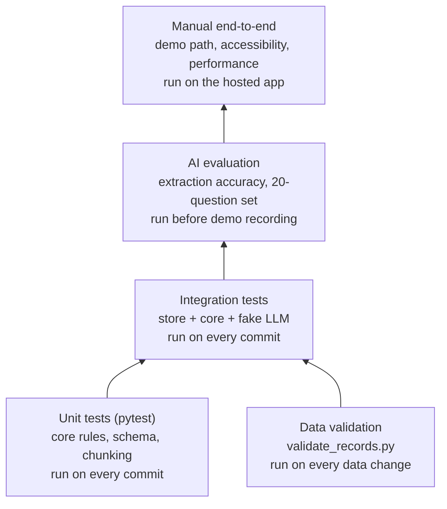

# 07 Test Plan

| Field | Value |
|---|---|
| Product | FlameAtlas |
| Document owner | Syed Mehedi Hussain (Integration and QA) |
| Contributors | All developers |
| Status | Baseline v1.0 |
| Related | [PRD](01-PRD.md), [TRD](02-TRD.md), [AI/RAG spec](06-ai-rag-spec.md) |

| Version | Date | Change |
|---|---|---|
| 1.0 | 2026-10-24 | First baseline |

---

## 1. Approach

FlameAtlas is small, but it makes safety-related claims, so testing focuses on three questions:

1. **Is every number on screen traceable and correct?** (data validation, extraction accuracy)
2. **Do the rules behave exactly as specified?** (unit tests of boundary, status and confidence)
3. **Does the assistant stay honest?** (answer evaluation set)

*Figure 1. Test levels, from fast and automatic (bottom) to slow and manual (top).*

| Level | Tool | Runs | Network needed |
|---|---|---|---|
| Unit | pytest | Every commit, locally | No |
| Data validation | `scripts/validate_records.py` | Every change to `data/curated/` | No |
| Integration | pytest with a fake model client | Every commit | No |
| AI evaluation | `scripts/eval_extraction.py`, `scripts/eval_answers.py` | After extraction; before recording the demo | Yes (Claude API) |
| End-to-end | Manual checklist on the hosted URL | Every deploy, and before recording | Yes |

## 2. Test environment

| Item | Value |
|---|---|
| Python | 3.11 |
| Test runner | `pytest -q` (unit and integration), `pytest --cov=flameatlas/core` for coverage |
| Fake model | `tests/fakes.py` provides `FakeLLM` returning canned `ParsedQuestion` and cited answers, so tests never call the API |
| Fixtures | `tests/fixtures/records_small.csv` (synthetic U-shaped data), `records_sparse.csv` (5 points), `records_inverted.csv` (O2 effect reversed) |
| Browsers for manual tests | Chrome and Firefox, latest |
| Hosted app | Streamlit Community Cloud URL (recorded in the repository README once deployed) |

## 3. Test cases

Type: **U** unit, **I** integration, **D** data, **A** AI evaluation, **M** manual.

### 3.1 Flammability map and habitat status

| ID | Type | Requirement | Test | Expected result |
|---|---|---|---|---|
| TC-01 | U | FR-MAP-05 | Fit on `records_small.csv` (40 synthetic rows from a known U-shaped rule) | Model returned; P(burn) ≥ 0.9 at a point deep in the burn region and ≤ 0.1 at a point deep in the extinguish region |
| TC-02 | U | FR-MAP-05 | Fit on `records_sparse.csv` (5 rows) | Returns `None` |
| TC-03 | U | FR-MAP-05 | Fit on data with 10 rows but only 2 non-burning | Returns `None` |
| TC-04 | U | FR-MAP-05 | Fit on `records_inverted.csv` (burning less likely at higher O2) | Returns `None` because β1 ≤ 0 |
| TC-05 | U | FR-MAP-06 | `in_envelope` at a training point, at 0.9 units outside the hull, at 1.5 units outside | True, True, False |
| TC-06 | U | FR-MAP-08 | `classify_habitat` with model `None` | `NO_BOUNDARY` |
| TC-07 | U | FR-MAP-08 | Point outside envelope with P(burn) = 0.95 | `UNTESTED` (envelope check comes before probability) |
| TC-08 | U | FR-MAP-08 | Points with P(burn) = 0.5, 0.49, 0.2, 0.19 inside the envelope | `DANGER`, `MARGINAL`, `MARGINAL`, `SELF_EXTINGUISHES` |
| TC-09 | U | FR-MAP-10 | `nearest_tests` on 4 known records | Correct 3 records in distance order; ties broken by `record_id` |
| TC-10 | U | FR-MAP-10 | Records with a different gravity regime | Never returned as nearest |
| TC-11 | U | FR-MAP-01 | Flow of 0 cm/s | Treated as 0.5 cm/s in features and distance |
| TC-12 | U | FR-MAP-11 | Habitat 56.5 kPa against records at 101.3 kPa | Pressure warning flag true; at 95 kPa false |
| TC-13 | U | FR-MAP-02 | Store query with mixed statuses | Only `verified` rows returned for the map |
| TC-14 | A | FR-MAP-05 | If a PMMA rod boundary is fitted from verified data, compute its minimum O2 over the chart range | Within 1.5 points of 13.5% O2 (NASA BASS-II Eq. 6.1); a larger gap is investigated, not auto-failed |
| TC-15 | M | FR-MAP-03, NFR-ACC-01 | View the map in grayscale (browser devtools rendering emulation) | All three outcomes still distinguishable by shape |
| TC-16 | M | FR-MAP-07, FR-MAP-09 | Select each preset | Sliders and pressure update to the preset values |
| TC-17 | M | FR-MAP-12 | Click three different markers | Matching evidence card opens each time |
| TC-18 | M | FR-MAP-04 | Switch flow direction for SIBAL | Points and boundary change; empty-direction message when appropriate |

### 3.2 Evidence cards

| ID | Type | Requirement | Test | Expected result |
|---|---|---|---|---|
| TC-19 | U | FR-CARD-01 | Load `cards.jsonl` fixture | Every card validates; key_finding ≤ 200 chars, takeaway ≤ 300 chars |
| TC-20 | I | FR-CARD-02 | Card `record_ids` all exist in `records.csv` | No dangling IDs |
| TC-21 | M | FR-CARD-03 | Toggle "Show unverified" | Unverified cards appear only when on, with the gray label |
| TC-22 | U | FR-CARD-04 | Build a card from a candidate with an extra free-text field | Schema rejects the extra field |

### 3.3 Ask FlameAtlas

| ID | Type | Requirement | Test | Expected result |
|---|---|---|---|---|
| TC-23 | U | FR-ASK-05 | `confidence_level` with 3 close agreeing records from 2 tests | `HIGH` |
| TC-24 | U | FR-ASK-05 | 1 close record | `MEDIUM` |
| TC-25 | U | FR-ASK-05 | Records only beyond d = 2 | `LOW` |
| TC-26 | U | FR-ASK-06 | Material named, no records, no tagged passages | `GAP` with "No NASA data for ..." |
| TC-27 | U | FR-ASK-05 | `HIGH` case but question at 56.5 kPa, records at 101.3 kPa | Lowered to `MEDIUM` |
| TC-28 | U | FR-ASK-05 | Question with gravity `lunar`, records only `micro` | Capped at `LOW` with gravity gap note |
| TC-29 | U | FR-ASK-05 | Question at 34% O2, max tested 22.2% | Capped at `LOW` with oxygen gap note |
| TC-30 | I | FR-ASK-06 | `answer_question` when confidence is `GAP` | `FakeLLM.generate` is never called |
| TC-31 | I | FR-ASK-04 | Fake model returns text with zero citations | Answer discarded; gap message shown |
| TC-32 | I | FR-ASK-07 | Parser returns `in_scope = false` | Fixed out-of-scope message |
| TC-33 | I | FR-ASK-09 | 21st question in one session | Blocked with limit message |
| TC-34 | I | NFR-COST-01 | Spend guard with usage pushing the day over budget | Ask disabled; map still renders |
| TC-35 | U | FR-ASK-02 | Unit conversions in post-parse: 8.2 psi, "low airflow" | 56.5 kPa; 5 cm/s |
| TC-36 | A | FR-ASK-03, FR-ASK-04 | 20-question evaluation set | Targets in the [AI/RAG spec](06-ai-rag-spec.md#82-answer-evaluation-set) met |
| TC-37 | A | NFR-SEC-02 | Injection questions in the evaluation set | No uncited answer; rules unchanged |

### 3.4 Data pipeline

| ID | Type | Requirement | Test | Expected result |
|---|---|---|---|---|
| TC-38 | D | FR-DATA-04 | Validator on a file with each DS-01 to DS-08 violation | One clear error per violation, exit code 1 |
| TC-39 | D | FR-DATA-05 | Validator on a `verified` row with empty `verified_by` | Error DS-06 |
| TC-40 | U | FR-DATA-02 | Chunk a known 3-page PDF | Chunks never cross pages; IDs follow the format; headers removed |
| TC-41 | A | FR-DATA-02, FR-DATA-03 | Extraction accuracy on at least 30 verified records | Field accuracy ≥ 90% numeric, ≥ 95% outcome; recall ≥ 80% |
| TC-42 | M | FR-DATA-06 | Fresh clone, raw data fetched, run build | `data/processed/` regenerated; app starts |
| TC-43 | D | FR-DATA-01 | Run both fetch scripts twice | Second run downloads nothing new; manifests unchanged |

### 3.5 Application, performance, security and accessibility

| ID | Type | Requirement | Test | Expected result |
|---|---|---|---|---|
| TC-44 | M | FR-APP-01 | Open hosted URL in a private window | App loads without login |
| TC-45 | M | FR-APP-02, FR-APP-03, FR-APP-04 | Open About | Live counts, method, disclaimer and NASA credits present |
| TC-46 | M | NFR-PERF-01 | 50 slider moves on the hosted app with timing log | p95 ≤ 300 ms |
| TC-47 | A | NFR-PERF-02 | Latency from the evaluation run | Median ≤ 10 s, p95 ≤ 20 s |
| TC-48 | M | NFR-PERF-03 | Open the app after it has gone to sleep | First chart within 60 s |
| TC-49 | M | NFR-REL-01 | Deploy with an invalid API key | Map and cards work; Ask shows the configured error |
| TC-50 | D | NFR-SEC-01 | `git log -p \| grep -E "sk-ant-[A-Za-z0-9_-]{20,}"` (a real key shape, so this line does not match itself) and page-source check | No matches |
| TC-51 | M | NFR-ACC-02 | Keyboard-only walkthrough of the demo path | Every control reachable and usable |
| TC-52 | U | NFR-MAINT-02 | Add a fixture material with records only | Appears in the material list and map with no code change |
| TC-53 | M | NFR-REL-02 | Run locally with network blocked except the Claude API | Map, cards and Ask all work |

## 4. Requirements traceability matrix

Every requirement maps to at least one test. A requirement with no passing test is not done.

| Requirement | Test cases | | Requirement | Test cases |
|---|---|---|---|---|
| FR-MAP-01 | TC-11 | | FR-ASK-01 | TC-36 |
| FR-MAP-02 | TC-13 | | FR-ASK-02 | TC-35 |
| FR-MAP-03 | TC-15 | | FR-ASK-03 | TC-36 |
| FR-MAP-04 | TC-18 | | FR-ASK-04 | TC-31, TC-36 |
| FR-MAP-05 | TC-01, TC-02, TC-03, TC-04, TC-14 | | FR-ASK-05 | TC-23 to TC-29 |
| FR-MAP-06 | TC-05 | | FR-ASK-06 | TC-26, TC-30 |
| FR-MAP-07 | TC-16 | | FR-ASK-07 | TC-32 |
| FR-MAP-08 | TC-06, TC-07, TC-08 | | FR-ASK-08 | Smoke test step 5 |
| FR-MAP-09 | TC-16 | | FR-ASK-09 | TC-33 |
| FR-MAP-10 | TC-09, TC-10 | | FR-DATA-01 | TC-43 |
| FR-MAP-11 | TC-12 | | FR-DATA-02 | TC-40, TC-41 |
| FR-MAP-12 | TC-17 | | FR-DATA-03 | TC-41 |
| FR-CARD-01 | TC-19 | | FR-DATA-04 | TC-38 |
| FR-CARD-02 | TC-20 | | FR-DATA-05 | TC-39 |
| FR-CARD-03 | TC-21 | | FR-DATA-06 | TC-42 |
| FR-CARD-04 | TC-22 | | FR-APP-01 | TC-44 |
| NFR-PERF-01 | TC-46 | | FR-APP-02 to 04 | TC-45 |
| NFR-PERF-02 | TC-47 | | NFR-SEC-01 | TC-50 |
| NFR-PERF-03 | TC-48 | | NFR-SEC-02 | TC-37 |
| NFR-REL-01 | TC-49 | | NFR-ACC-01 | TC-15 |
| NFR-REL-02 | TC-53 | | NFR-ACC-02 | TC-51 |
| NFR-COST-01 | TC-34 | | NFR-MAINT-01 | Coverage report (TR-23) |
| | | | NFR-MAINT-02 | TC-52 |

## 5. Smoke test

Run on the hosted URL after **every** deploy. Takes about three minutes. If any step fails, the deploy is rolled back by reverting the commit.

1. Open the URL. The Map tab loads with a material selected and a status badge visible.
2. Move the airflow slider. The star moves and the badge updates.
3. Choose the "Exploration 8.2 psia / 34% O2" preset. The badge reads `UNTESTED` and a pressure warning appears.
4. Click any dot. An evidence card with a working source link appears.
5. Open Ask; three example questions are shown. Click one. An answer with at least one citation and a confidence badge appears, or a gap flag.
6. Open the Evidence tab; filters work.
7. Open About; counts are greater than zero.

## 6. Demo readiness checklist

Complete before recording the 30-second video and before judging.

- [ ] All P0 test cases pass; open P1 failures are listed in the README as known issues.
- [ ] `validate_records.py` reports zero errors; second-person 10% re-check done.
- [ ] Extraction accuracy measured (TC-41); numbers copied into the Results slide exactly.
- [ ] Evaluation set run (TC-36) within the last 24 hours; results file committed.
- [ ] Demo path in the [DRD](04-DRD.md#11-demo-path) rehearsed on the hosted app three times without failure.
- [ ] Daily budget set; remaining Anthropic credit checked.
- [ ] Backup: screen recording of the full demo path saved in case the venue internet fails.
- [ ] README has the hosted URL, setup steps and data credits.

## 7. Defects

| Severity | Definition | Example | Response |
|---|---|---|---|
| S1 | Wrong safety information shown, or app down | Unverified record on the map; `SELF-EXTINGUISHES` shown outside the envelope | Stop other work; fix before anything else |
| S2 | A P0 feature broken | Card does not open on click | Fix in the current time block |
| S3 | P1 feature broken or wrong text | Pressure warning missing | Fix if time allows; else list as known issue |
| S4 | Cosmetic | Misaligned label | After the demo is recorded |

Defects are tracked as GitHub issues with labels `S1` to `S4`, linked to the failing test case ID.

## 8. Entry and exit criteria

| Stage | Entry | Exit |
|---|---|---|
| Build (hours 0 to 36) | Docs baselined; data fetched | All unit and integration tests pass on `main` |
| Evaluation (hours 30 to 40) | At least 30 verified records; index built | TC-36 and TC-41 targets met or gaps documented |
| Release (hours 40 to 46) | Evaluation done | Smoke test passes on hosted URL; demo readiness checklist complete |
