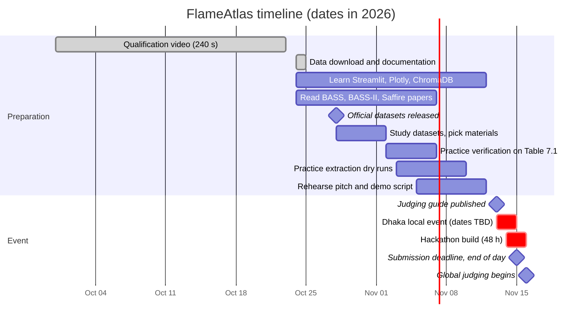

# 08 Project Plan

| Field | Value |
|---|---|
| Product | FlameAtlas |
| Document owner | Md. Mahmudul Hasan (Team Lead) |
| Status | Baseline v1.0 |
| Related | [Risk register](09-risk-register.md), [Test plan](07-test-plan.md) |

| Version | Date | Change |
|---|---|---|
| 1.0 | 2026-10-24 | First baseline |

---

## 1. Team and ownership

| Member | Role | Owns end to end | Documents owned |
|---|---|---|---|
| Md. Mahmudul Hasan | Team Lead, AI and RAG | Direction, extraction, Chroma index, Ask | PRD, AI/RAG spec, project plan, risks |
| Opi Mojumdar | Dashboard Developer | Streamlit layout, Plotly map, sliders, cards UI | DRD |
| Aurin Subah | Data and Science Developer | Papers, materials, verifying every record, boundary science | Data spec, glossary |
| Syed Mehedi Hussain | Integration and QA Developer | Repository, build, tests, deployment, smoke tests | TRD, SDD, test plan |
| Farhan Alam Chowdhury | Story and Presentation Lead | Pitch, videos, project page, plain-language copy | Glossary (with Aurin), demo script |

Each person owns one part so nobody waits on anyone else. The interfaces between parts are the function contracts in the [TRD](02-TRD.md#62-core-function-contracts) and the file schemas in the [data spec](05-data-spec.md#4-schemas).

### 1.1 RACI

R = responsible (does it), A = accountable (signs off), C = consulted, I = informed.

| Activity | Mahmudul | Opi | Aurin | Syed | Farhan |
|---|---|---|---|---|---|
| Product scope and priorities | A, R | C | C | C | C |
| Material selection | C | I | A, R | I | C |
| Extraction prompts and runs | A, R | I | C | I | I |
| Record verification | I | I | A, R | R (10% re-check) | I |
| Boundary model and status rules | C | C | A, R | C | I |
| Map and UI | C | A, R | C | C | C |
| Ask (retrieval, confidence, answers) | A, R | C | C | C | I |
| Repository, build, CI, deploy | C | C | I | A, R | I |
| Testing and evaluation | C | C | C | A, R | I |
| Pitch, videos, project page | C | C | C | I | A, R |
| Final submission | A | C | C | R | R |

## 2. Timeline

*Figure 1. Preparation and event timeline. The Dhaka program schedule lists Day 1 as Friday 13 November and Day 2 as Saturday 14 November, while the global hackathon runs 14 to 15 November; the exact local hours are TBD with the Local Lead (risk R-10).*

### 2.1 Milestones

| ID | Milestone | Date | Done when |
|---|---|---|---|
| M0 | Documentation baseline | 2026-10-24 | All 11 documents committed (this set) |
| M1 | Materials chosen | 2026-11-02 | 5 to 8 materials listed in `materials.csv` with sources |
| M2 | Workflow rehearsed | 2026-11-10 | Team has practiced verification and extraction on sample data; timings known |
| M3 | Map works (hackathon) | Hour 16 | Map shows verified points and a boundary for at least 2 materials |
| M4 | Ask works (hackathon) | Hour 30 | Ask returns cited answers with confidence and gap flags |
| M5 | Evaluated (hackathon) | Hour 40 | TC-36 and TC-41 run; numbers recorded |
| M6 | Submitted | Hour 46 | Project page, demo and repository submitted with 2 hours of buffer |

## 3. Preparation phase (now to 13 November)

Space Apps projects are built during the hackathon. Before it, the team learns the tools, studies the science and prepares data, in line with the assumption in [PRD A-5](01-PRD.md#10-assumptions-and-dependencies). Practice code is written in a separate scratch folder, not in this repository's `flameatlas/` package.

| Person | Preparation tasks | Output |
|---|---|---|
| Mahmudul | Practice Claude structured outputs, citations and batches on 3 papers; draft the extraction and answer prompts in the AI/RAG spec | Prompt drafts; measured cost per paper |
| Opi | Build a throwaway Streamlit page with a Plotly log-axis scatter, a contour and a click event | Notes on `on_select` behavior and chart performance |
| Aurin | Read BASS-II Sections 5 to 7 and Saffire-II results; hand-enter Table 7.1 as practice in a spreadsheet using the data spec rules | Practice sheet; list of rule questions |
| Syed | Practice ChromaDB persistence and Streamlit Cloud deployment of a hello-world app; write the validator outline | Deployment notes; known pitfalls (SQLite version) |
| Farhan | Draft the 30-second video storyboard from the DRD demo path; prepare project-page text with placeholders | Storyboard; page draft |

## 4. Hackathon run sheet

H0 is the official start of the build. Times are hours since H0. Each block ends with a 10-minute sync.

| Hours | Mahmudul (AI) | Opi (UI) | Aurin (Data) | Syed (Integration) | Farhan (Story) |
|---|---|---|---|---|---|
| H0 to H2 | Confirm scope with team; set up API key and budget | App skeleton: tabs, layout, material selector | Load materials and sources lists | Repository skeleton, `requirements.txt`, CI-free test run, Streamlit Cloud app created | Project page skeleton; team photos |
| H2 to H8 | Chunk and index all papers; launch extraction batch | Map with hand-made sample data: axes, markers, legend | Enter Table 7.1 and Table 5.1 records (`manual_table`) | Schema, store, validator; first unit tests | Plain-language copy for statuses and About |
| H8 to H16 | Load extraction results into `records.csv` | Habitat sliders, presets, status badge | Verify extracted records, highest-yield sources first | Boundary fit and classification with tests (pairs with Aurin) | Storyboard update with real screenshots |
| **H16** | | **M3: map works** | | | |
| H16 to H24 | Retrieval and question parser | Evidence card on click; Evidence tab | Continue verification; card text checks | Integrate map with verified data; deploy; smoke test | Rest |
| H24 to H30 | Confidence rule, answer generation, gap flags | Ask tab UI | Rest, then verification | Spend guard, session limit, fake LLM tests | Draft slides |
| **H30** | **M4: Ask works** | | | | |
| H30 to H36 | Evaluation set run, prompt fixes | Accessibility pass, empty states | Second-person 10% re-check with Syed; extraction accuracy | Full test pass; performance check | Record narration draft |
| H36 to H40 | Fix evaluation failures | Polish copy and layout | Final record count; Results numbers | Final deploy; smoke test; README | Capture demo footage |
| **H40** | | | **M5: evaluated** | | |
| H40 to H44 | Support video and page | Support video | Check every number in the video and page | Freeze `main`; tag `v1.0` | Edit 30-second video with subtitles |
| H44 to H46 | Final review of submission | | | Submit repository link | Submit project page and demo |
| **H46** | | | | | **M6: submitted** |
| H46 to H48 | Buffer | Buffer | Buffer | Buffer | Buffer |

Sleep rule: each person takes at least one 4-hour block off between H18 and H34, staggered so that the data and integration owners are never both off.

## 5. Ways of working

| Practice | Rule |
|---|---|
| Branches | One short-lived branch per task, named `<owner>/<task>`, for example `opi/habitat-sliders` |
| Merging | Pull request into `main`; Syed reviews; tests must pass; small PRs (under 300 lines) |
| Data changes | Only Aurin merges changes to `data/curated/records.csv` |
| Secrets | Never in git; each developer uses a local `.env` |
| Stand-ups | 10 minutes at each block boundary in the run sheet: done, next, blocked |
| Decisions | Any change to scope or a rule gets one line in the [decision log](10-decisions.md) |
| Definition of done | Code merged, tests passing, requirement's test cases pass, docs updated if behavior changed |

## 6. Deliverables checklist

| Deliverable | Owner | Status |
|---|---|---|
| 240-second qualification video | Farhan | Done |
| Documentation set (`docs/`) | Whole team | Baseline done 2026-10-24 |
| Data fetch scripts and source lists | Syed | Done 2026-10-24 |
| Working app at a public URL | Syed | Hackathon |
| 30-second demo video with English subtitles (or up to 7 slides) | Farhan | Hackathon |
| Project page on spaceappschallenge.org | Farhan | Hackathon |
| Results numbers (extraction accuracy, record counts) | Aurin | Hackathon |
| AI use statement on the project page | Mahmudul | Hackathon |
