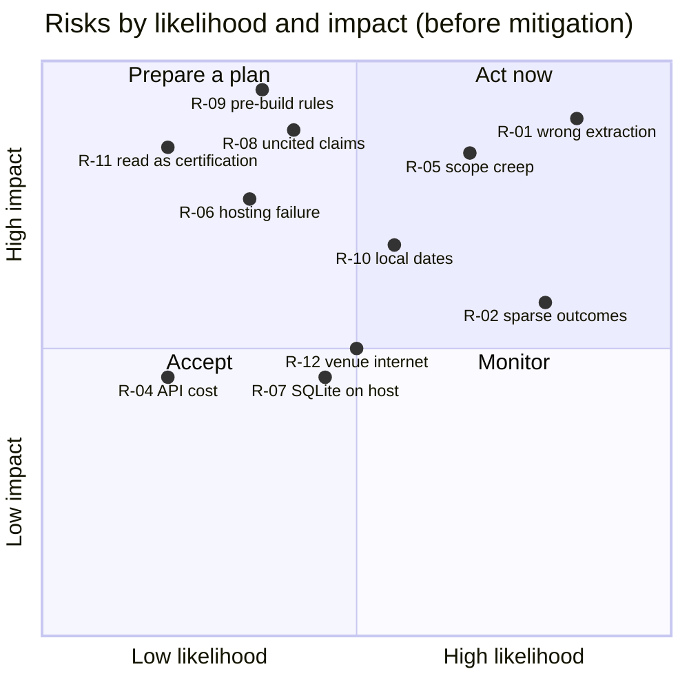

# 09 Risk Register

| Field | Value |
|---|---|
| Product | FlameAtlas |
| Document owner | Md. Mahmudul Hasan (Team Lead) |
| Status | Baseline v1.0; reviewed at every stand-up during the hackathon |
| Related | [Project plan](08-project-plan.md), [Test plan](07-test-plan.md) |

| Version | Date | Change |
|---|---|---|
| 1.0 | 2026-10-24 | First baseline; R-02 and R-16 updated with findings from the data download |

---

## 1. Scoring

| Score | Likelihood | Impact |
|---|---|---|
| 1 | Unlikely (under 20%) | Minor: cosmetic or easily worked around |
| 2 | Possible (20% to 50%) | Moderate: a P1 feature or some hours lost |
| 3 | Likely (over 50%) | Severe: a P0 feature lost, wrong safety information shown, or disqualification |

**Exposure = likelihood × impact.** Risks with exposure 6 or more are reviewed at every stand-up.

## 2. Risk map

*Figure 1. Main risks placed by likelihood (x) and impact (y). Positions match the scores in Section 3.*

## 3. Register

| ID | Risk | L | I | Exp. | Mitigation | Contingency (if it happens) | Owner | Status |
|---|---|---|---|---|---|---|---|---|
| R-01 | The model extracts wrong numbers or outcomes | 3 | 3 | 9 | Model only proposes; every record is hand-checked against its locator; 10% second-person re-check; accuracy measured (TC-41) | Drop the affected source from the map; show its card as unverified | Aurin | Open |
| R-02 | Too few outcome records for some materials. **Confirmed in part:** PSI tables log conditions but rarely outcomes | 3 | 2 | 6 | Prioritize sources with outcome tables (BASS-II Tables 5.1 and 7.1, Saffire-II); allow `manual_figure` entry; choose materials by data density | Show points only (`NO BOUNDARY`) and lean on research-gap flags, which are themselves a feature | Aurin | Open |
| R-03 | Official datasets (2026-10-28) differ from what we expect | 2 | 2 | 4 | Pipeline is source-agnostic; only `sources.csv` and `materials.csv` change | Re-pick materials on Oct 28 to Nov 2 | Aurin | Open |
| R-04 | Language model cost or rate limits | 1 | 2 | 2 | Batch API at 50% price; cached extraction; spend guard; per-session limit | Switch `FLAMEATLAS_MODEL` to the cheaper model (ADR-0004) | Mahmudul | Open |
| R-05 | Scope creep beyond three features | 2 | 3 | 6 | MoSCoW list in the PRD; any new feature needs a decision-log entry; P2 only after M5 | Cut P1 items in this order: presets, nearest tests, Evidence tab filters | Mahmudul | Open |
| R-06 | Hosting fails or sleeps during judging | 2 | 3 | 6 | Bundled data; smoke test after each deploy; visit the app before judging to wake it | Backup deploy on Hugging Face Spaces; recorded demo video | Syed | Open |
| R-07 | ChromaDB needs a newer SQLite than the host provides | 2 | 2 | 4 | Tested in preparation with a hello-world deploy | `pysqlite3-binary` swap (TRD Section 7) | Syed | Open |
| R-08 | Assistant states facts without support | 2 | 3 | 6 | Native citations; answers without citations discarded; `GAP` skips generation; evaluation set with faithfulness review | Disable free answers and show only retrieved passages with confidence | Mahmudul | Open |
| R-09 | Pre-hackathon work breaks Space Apps rules | 2 | 3 | 6 | Before the event: documents, data download and learning only; product code written during the hackathon; practice code kept outside `flameatlas/` | Ask the Local Lead now; if anything is disallowed, remove it from the repository before the event | Mahmudul | **Action: confirm with Local Lead** |
| R-10 | Confusion over Dhaka local dates (program schedule says Fri 13 to Sat 14 November; global build is 14 to 15 November) | 2 | 3 | 6 | Confirm hours with the Local Lead; plan the run sheet in relative hours | Shift the run sheet; keep the global submission deadline as the hard stop | Syed | **Action: confirm with Local Lead** |
| R-11 | Users read the map as a safety certification | 1 | 3 | 3 | No "safe" label; `UNTESTED` state; disclaimer in About and under the badge | Strengthen the disclaimer text | Farhan | Open |
| R-12 | Venue internet is slow or down | 2 | 2 | 4 | All data and the index bundled; only the Claude API needs the network | Run locally on a laptop; use a phone hotspot for the API; demo from the recording | Syed | Open |
| R-13 | A team member is unavailable or exhausted | 2 | 2 | 4 | One owner per part with written specs; staggered sleep blocks | The owner's specs let another member continue; cut that part's P1 items | Mahmudul | Open |
| R-14 | AI use is not disclosed as Space Apps requires | 1 | 3 | 3 | AI use statement is a listed deliverable (project plan Section 6) | Add the statement before the deadline | Mahmudul | Open |
| R-15 | Copyright on some NTRS conference papers | 1 | 2 | 2 | PDFs are not redistributed (git-ignored); only short quotes shown; always link to NTRS | Remove the source from the index | Aurin | Open |
| R-16 | NASA source files missing from PSI storage. **Realized:** 9 of 154 files return `NoSuchKey`, including the BASS final report | 3 | 1 | 3 | Documented in the manifest; BASS covered by NTRS 20140011099 and the BASS-II summary report | None needed | Syed | Closed |
| R-17 | 2026 judging criteria or submission rules differ from past years | 1 | 2 | 2 | Criteria mapping kept in one table (PRD Section 11) | Update wording when the guide is published (TBD Nov 13) | Farhan | Open |
| R-18 | Boundary fit misleads (for example extrapolating into untested areas) | 2 | 3 | 6 | Envelope check before probability; data-sufficiency rule; O2 coefficient sign check; TC-14 sanity check against NASA's published boundary | Show points only for the affected material | Aurin | Open |

## 4. Review log

| Date | Change |
|---|---|
| 2026-10-24 | Register created. R-02 confirmed in part by inspecting PSI tables. R-16 realized and closed. R-09 and R-10 assigned actions. |
