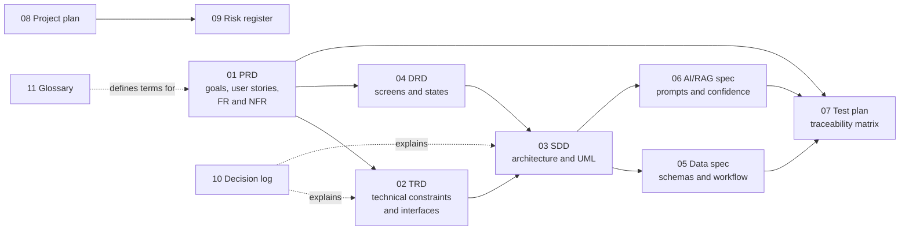

# FlameAtlas Documentation

> **Know what burns before you fly.**
> FlameAtlas turns NASA's microgravity fire research into an interactive flammability map, one evidence card per study, and an assistant that answers only from cited NASA sources.

This folder is the single source of truth for what FlameAtlas is, how it is built, and how we prove it works. It is written for two audiences at once:

- **The team** builds from it during the 48-hour hackathon. Every requirement has an ID, an owner, and a test.
- **Judges and mentors** can read it to check that each claim the app makes is traceable to NASA data.

| Item | Value |
|---|---|
| Event | NASA Space Apps Challenge 2026, theme "The Next Frontier" |
| Challenge | Flame in Freefall (AI dashboard for microgravity combustion research) |
| Local event | Dhaka, Bangladesh |
| Repository | https://github.com/MahmudulHasanJoy/FlameAtlas |
| Documentation status | Baseline v1.0, 2026-10-24 (before the official challenge datasets are released on 2026-10-28) |

## Reading order

| # | Document | Read it if you need to know | Primary owner |
|---|---|---|---|
| 01 | [Product Requirements (PRD)](01-PRD.md) | What we are building, for whom, and how we know it succeeded | Md. Mahmudul Hasan |
| 02 | [Technical Requirements (TRD)](02-TRD.md) | The constraints, stack, interfaces and quality targets the build must meet | Syed Mehedi Hussain |
| 03 | [System Design (SDD)](03-SDD.md) | How the parts fit together: architecture, UML, sequences, deployment | Syed Mehedi Hussain |
| 04 | [Design Requirements (DRD)](04-DRD.md) | What every screen looks like and how it behaves | Opi Mojumdar |
| 05 | [Data Specification](05-data-spec.md) | Sources, schemas, units, and the hand-check workflow for every data point | Aurin Subah |
| 06 | [AI and RAG Specification](06-ai-rag-spec.md) | Extraction prompts, retrieval, the confidence formula, research-gap logic | Md. Mahmudul Hasan |
| 07 | [Test Plan](07-test-plan.md) | How each requirement is verified, plus the traceability matrix | Syed Mehedi Hussain |
| 08 | [Project Plan](08-project-plan.md) | Who does what, when, and the hour-by-hour hackathon run sheet | Md. Mahmudul Hasan |
| 09 | [Risk Register](09-risk-register.md) | What can go wrong and what we do about it | Md. Mahmudul Hasan |
| 10 | [Decision Log](10-decisions.md) | Why we chose each tool and rule (architecture decision records) | Whole team |
| 11 | [Glossary](11-glossary.md) | Combustion, NASA and AI terms in plain language | Aurin Subah, Farhan Alam Chowdhury |

New to the project? Read the PRD summary, then the SDD context diagram, then the glossary. Building a specific part? Go straight to its spec and the matching rows of the traceability matrix in the test plan.

## How the documents connect



## Conventions used in every document

**Requirement IDs.** Each requirement has a stable ID that is never reused:

| Prefix | Meaning | Defined in |
|---|---|---|
| `G-n` | Product goal | PRD |
| `US-nn` | User story | PRD |
| `FR-<AREA>-nn` | Functional requirement (`MAP`, `CARD`, `ASK`, `DATA`, `APP`) | PRD |
| `NFR-<CAT>-nn` | Non-functional requirement (`PERF`, `REL`, `SEC`, `ACC`, `COST`, `MAINT`) | PRD, refined in TRD |
| `TR-nn` | Technical requirement | TRD |
| `DR-nn` | Design requirement | DRD |
| `DS-nn` | Data rule | Data spec |
| `AI-nn` | AI and retrieval rule | AI/RAG spec |
| `TC-nn` | Test case | Test plan |
| `R-nn` | Risk | Risk register |
| `ADR-nnnn` | Architecture decision record | Decision log |

**Keywords.** "Must" means required for the hackathon submission. "Should" means expected unless time runs out. "May" means stretch goal. This follows RFC 2119.

**Priority.** `P0` must ship in the demo; `P1` should ship; `P2` only if the core is finished early.

**TBD markers.** Anything that depends on information we do not have yet is written as **`TBD(<trigger>)`**. For example, `TBD(Oct 28)` resolves when the official challenge datasets are released and `TBD(Nov 13)` when the 2026 judging guide is published. Search the folder for `TBD(` to see every open item.

**Units.** Oxygen is percent by volume (`% O2`), flow speed is cm/s, pressure is kPa (psia given in brackets where NASA uses it), spread rate is mm/s, gravity is in multiples of Earth gravity (`g`).

**Diagrams.** All diagrams are [Mermaid](https://mermaid.js.org/) blocks. They render on GitHub and are edited as text, so they stay in sync with the documents.

**Data provenance.** Any number quoted in these documents that comes from NASA cites its source by NTRS id (for example `NTRS 20210011385`) or PSI accession (for example `PSI-25`). The raw files are listed in [`data/raw/psi/manifest.csv`](../data/raw/psi/manifest.csv) and [`data/raw/ntrs/manifest.csv`](../data/raw/ntrs/manifest.csv).

## Getting the data

The raw NASA data is not stored in git (about 440 MB). Recreate it with:

```bash
python scripts/fetch_psi.py    # NASA Physical Sciences Informatics: 24 combustion investigations
python scripts/fetch_ntrs.py   # 43 curated NASA Technical Reports Server papers
```

Both scripts use only the Python standard library and skip files that are already present.

## Changing these documents

1. Edit the Markdown in place. Keep IDs stable; mark removed requirements `Withdrawn` instead of deleting them.
2. If a change alters a decision, add a new ADR to the [decision log](10-decisions.md) rather than rewriting an old one.
3. Update the traceability matrix in the [test plan](07-test-plan.md) whenever a requirement is added or withdrawn.
4. Record the change in the revision table at the top of the document you edited.
